<div align="center">


# information-hub · 资讯汇集

**由人精选、AI 协助整理的团队私有知识库。**

把你在 X 上发现的好内容分享进来，整理原文、图片和译文，<br>让团队在同一个地方阅读、查找和积累。

[快速部署](#快速部署) · [iPhone 快捷指令](#iphone-快捷指令) · [AI 接入（MCP）](#ai-接入mcp) · [后台配置](#后台配置) · [运维](#运维)

  

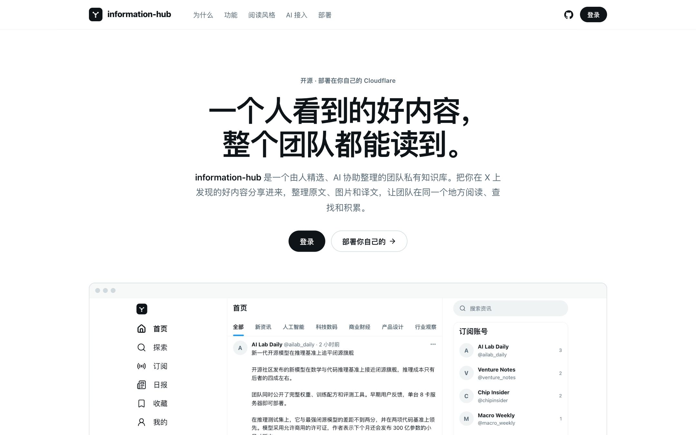

</div>

## 为什么做这个项目

做这个项目，起因是一个观察：在 X 上，能看到不少开发者、研究者和创业者直接交流技术进展、实践经验和自己的判断。有些讨论还没有变成正式文章，却已经值得团队关注。

**但一个人看到了，不代表整个团队都能读到。**

把链接发进群里，伙伴可能打不开，也可能没有时间读完外文。手动复制、翻译、整理图片很费事；经过几轮转述，原作者的表达也容易走样。

information-hub 想做的，是让“一个人看到”变成“整个团队读到”：在 X 里点一下分享，原文、图片和中文译文被完整保存，按天归档、按主题整理；谁分享的、什么时候分享的，一目了然。

## 功能

| | |
|---|---|
| 📱 **专属快捷指令** | iPhone 上在 X 里点分享即可收录。每人一个连接地址，分享自动记在本人名下。附图文教程。 |
| 🌐 **原文与译文并存** | 通过 TwitterAPI.io / X 官方 API / 公开预览获取原文、长文章和图片，大模型生成中文全文译文、摘要和主题分类，支持双语对照与 Markdown 下载。 |
| 📡 **订阅关键账号** | 后台订阅 X 账号，定时抓取新帖并自动翻译；新订阅只导入最新几条，避免刷屏。 |
| 🎯 **定向分析** | 写下团队关注方向，每条资讯额外生成分析要点和 0–100 相关度，可用于排序和推送过滤。 |
| 📰 **AI 每日日报** | 每天汇总要点、分主题速览、趋势洞察与跟进建议，只引用站内资讯；可定时或手动生成。 |
| 🔔 **飞书 / 企业微信推送** | 群机器人推送新资讯与日报（飞书支持签名校验），并可归档到飞书知识库，一天一篇文档。 |
| 🧠 **多模型可切换** | DeepSeek、OpenAI、Claude、通义千问、Kimi、智谱、豆包、硅基流动，或任意 OpenAI 兼容接口，后台一键切换。 |
| 🎨 **三种阅读风格** | X 信息流、小红书瀑布流、今日头条新闻列表，成员自选，手机和电脑一致，支持深色模式。 |
| 🔐 **账号与安全** | 首次部署设置超级管理员；免密登录链接；20 个一次性密码恢复码；运维重置命令；密钥加密存储、不回显。 |
| 🤖 **AI 友好** | `AGENTS.md` + 部署 skill + 一条命令部署，AI 编程助手在完成 Cloudflare 授权后可执行部署；MCP 接入，让 AI 助手直接搜索和阅读资讯库。 |

## 界面

**三种阅读风格**（每位成员在首页右侧或“我的账号”中切换）

| X 风格 | 小红书风格 | 今日头条风格 |
|---|---|---|
| 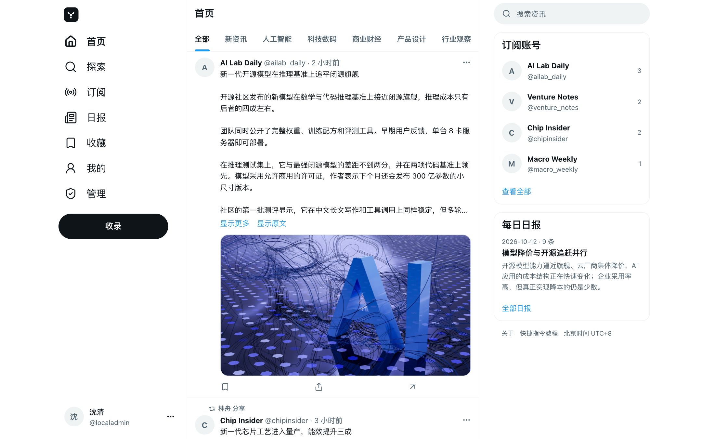 | 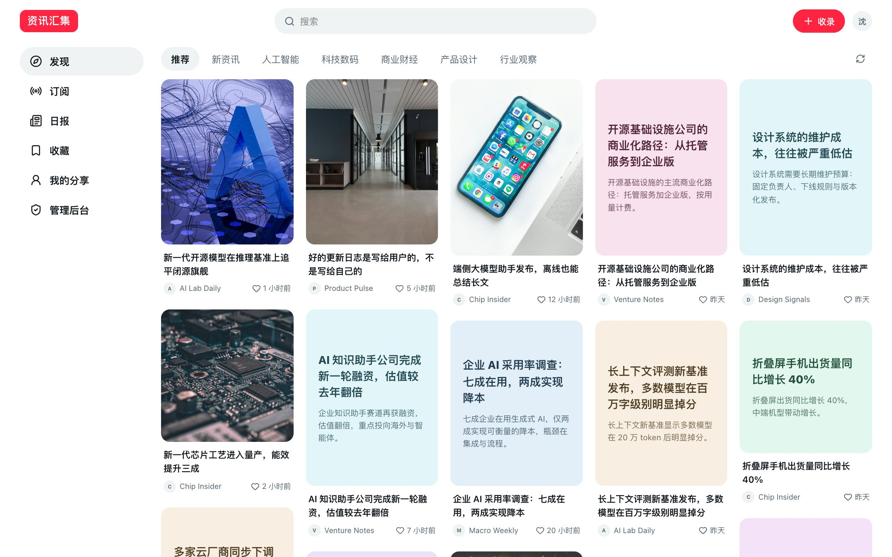 | 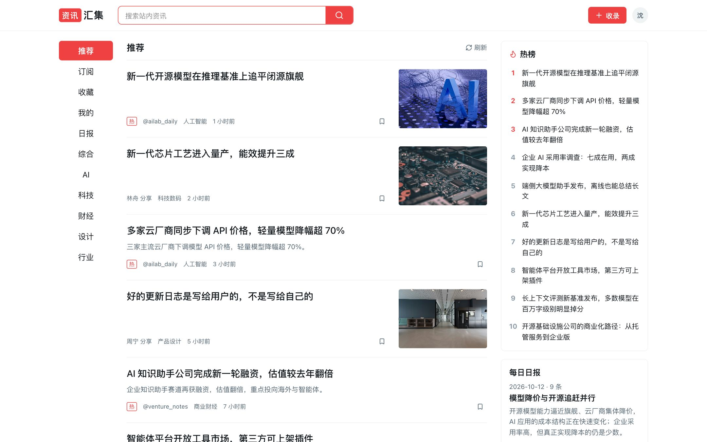 |

**手机端与深色模式**

| X | 小红书 | 今日头条 | 深色模式 |
|---|---|---|---|
| 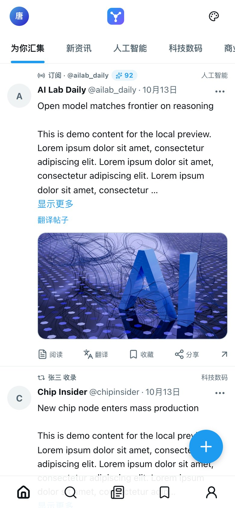 |  |  | 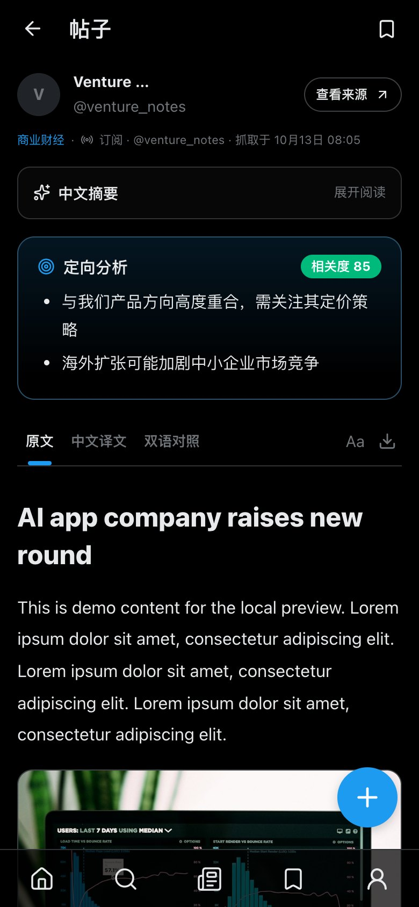 |

**阅读、日报与后台**

| 阅读页（定向分析） | AI 每日日报 |
|---|---|
| 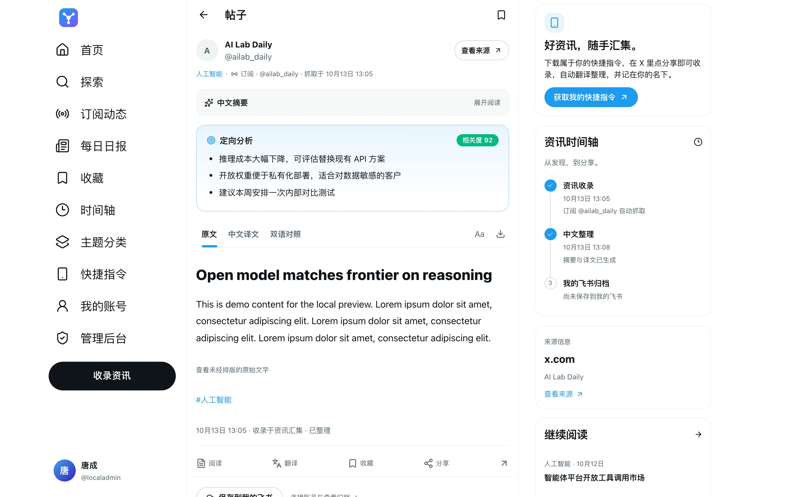 | 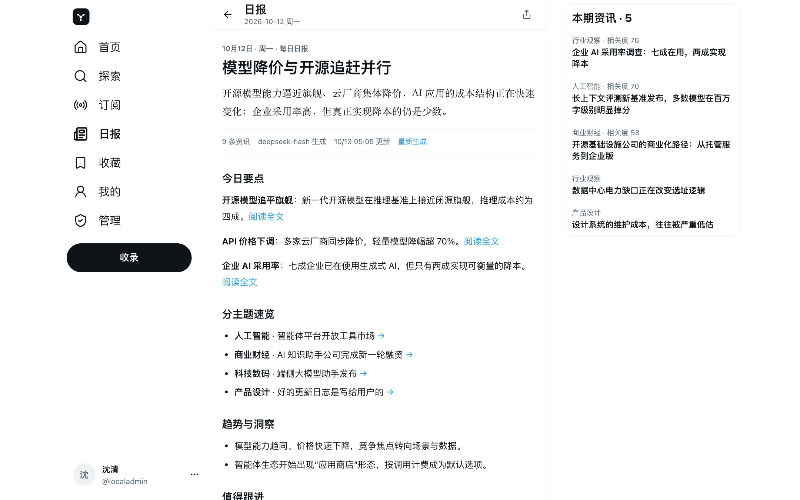 |
| **管理后台 · 概览** | **管理后台 · 抓取与模型** |
| 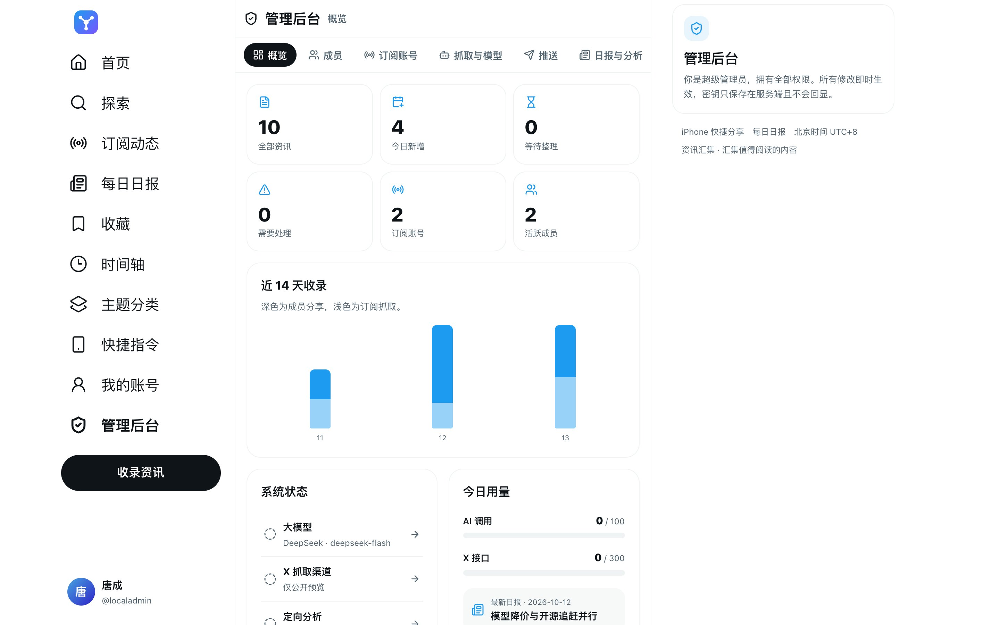 | 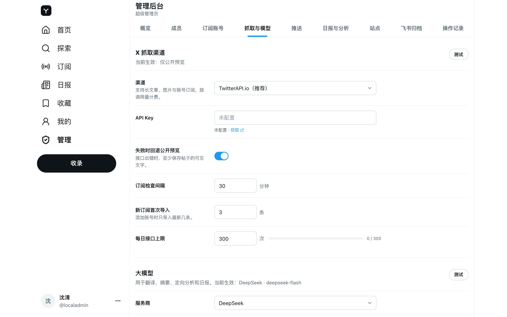 |
| **登录** | **我的账号** |
| 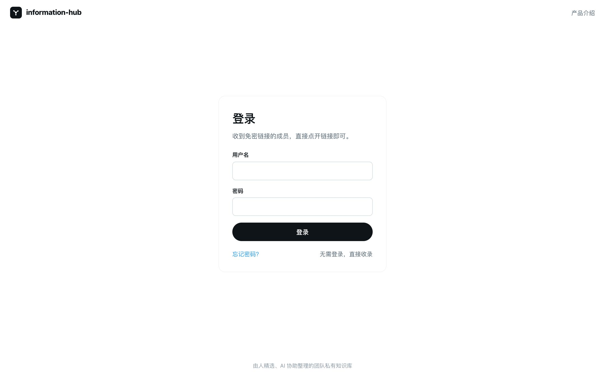 | 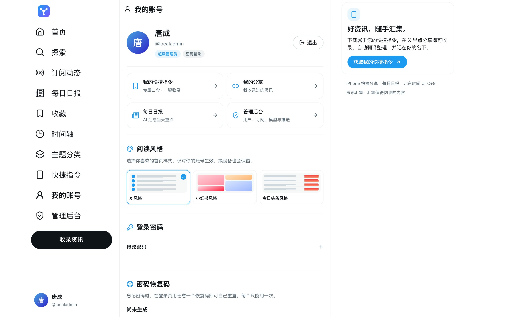 |

## 快速部署

运行在你自己的 Cloudflare 账号里（Workers + D1），不需要服务器。需要 Node.js ≥ 22.13。

### 方式一：交给 AI 编程助手（推荐）

在 Codex、Claude Code、WorkBuddy、Cursor 等工具里说一句：

> 克隆 https://github.com/Satyuki1/information-hub ，按仓库里的 AGENTS.md 把它部署到我的 Cloudflare。

仓库为 AI 准备了：

- [`AGENTS.md`](AGENTS.md)：项目说明、部署与验证步骤、代码地图（Codex / Cursor / WorkBuddy 等读取）。
- [`CLAUDE.md`](CLAUDE.md) 和 [`.claude/skills/deploy-information-hub`](.claude/skills/deploy-information-hub/SKILL.md)：Claude Code 的部署 skill，说“部署 information-hub”即可触发。
- [`/llms.txt`](public/llms.txt)：部署后站点上的机器可读说明。

AI 会在需要授权 Cloudflare 时请你在浏览器里点一下“允许”，这一步必须由你本人完成。

### 方式二：一条命令

```sh
git clone https://github.com/Satyuki1/information-hub.git
cd information-hub
npm ci
npx wrangler login      # 在浏览器中授权 Cloudflare
npm run deploy          # 首次可加 -- --name=my-hub 指定名称
```

`npm run deploy` 会自动完成：

1. 创建（或复用）D1 数据库，把账号与资源 ID 记到 `cloudflare/resources.json`（不提交到 Git）；
2. 构建并执行全部数据库迁移；
3. 发布 Worker，打印访问地址；
4. 首次部署时生成加密主密钥 `DATA_ENCRYPTION_KEY`，写入 Worker Secret，并备份到 `work/production-security/`；
5. 保存当前站点地址，生成一次性“创建超级管理员”链接，保存在 `work/bootstrap/管理员初始化.md`；
6. 检查公开页面能否访问，以及私有资讯接口是否拒绝匿名读取。

无人值守环境可用 `CLOUDFLARE_API_TOKEN`（Workers 脚本与 D1 编辑权限）和 `CLOUDFLARE_ACCOUNT_ID` 代替 `wrangler login`。

### 部署之后

1. **创建超级管理员**：由部署者打开 `work/bootstrap/管理员初始化.md` 中的私有链接，设置账号和密码。直接打开 `/setup` 仍需要初始化凭证。
2. **保存 20 个恢复码**：创建后页面会显示 20 个一次性密码恢复码，请下载保存，忘记密码时在登录页使用。
3. **后台配置**：`/admin → 抓取与模型` 选择大模型并填写 Key、选择 X 抓取渠道；按需开启推送、日报和定向分析。所有密钥都在网页里填写，加密保存。
4. **邀请团队**：`/admin → 成员` 添加账号，或生成“免密链接”直接发给对方；成员在 `/shortcut` 安装快捷指令。

> **请妥善备份 `DATA_ENCRYPTION_KEY`**：密码校验与后台保存的所有 API Key 都依赖它，丢失或随意更换会导致无法登录、密钥失效。
>
> 初始化始终要求部署者生成的私有链接。链接尚未生成、已过期或部署中断时，访客不能创建管理员；部署者可运行 `npm run setup-link` 重新生成。

### 更新

```sh
git pull && npm ci && npm run deploy
```

部署复用已记录的账号、Worker 和数据库，应用待执行迁移；当前迁移只做新增。读取远端资源或密钥列表失败时停止，不会把失败当作“尚未配置”。已有账号或加密配置却缺少主密钥时，需要恢复原备份。首次生成的密钥会先保存到本地，再上传。

请保留被 Git 忽略的 `cloudflare/resources.json`，它记录实例的资源对应关系。重新克隆后更新已有实例，应先恢复该文件。自定义域名已绑定时，可用 `npm run deploy -- --origin=https://你的域名` 指定公开地址。

## iPhone 快捷指令

成员登录后打开 **`/shortcut`**，点“复制连接地址并安装快捷指令”，在 iPhone 弹出的“设置此快捷指令”里粘贴一次即可。之后在 X 中点 **分享 → 分享到资讯汇集**，几秒钟提交完成，翻译整理在后台进行。公开的图文教程在 **`/guide`**。

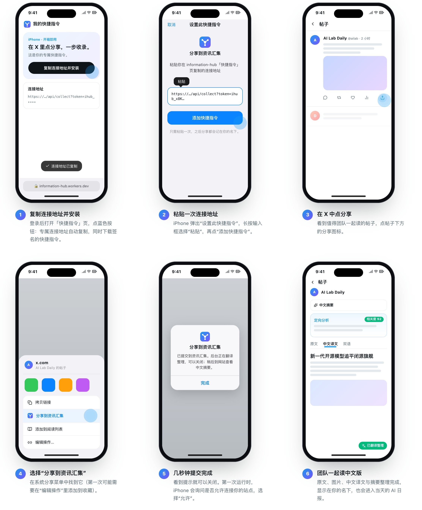

为什么要粘贴？iPhone 只能安装经过 Apple 签名的快捷指令，签名只能在 Mac 上完成，服务器无法为每个人单独生成。所以所有人（包括其他部署）安装同一份签名文件，粘贴的连接地址 `https://你的站点/api/collect?token=ihub_…` 同时带上了站点和个人口令。口令可在 `/shortcut` 随时重置；是否允许不带口令的匿名分享由后台“站点”设置控制。

重新签名：`python3 scripts/build-shortcut.py`，再在登录 Apple ID 的 Mac 上执行
`shortcuts sign --mode anyone --input outputs/zeng-share-unsigned.shortcut --output public/shortcuts/分享到资讯汇集.shortcut`。

## AI 接入（MCP）

每位成员在 **我的账号 → AI 接入（MCP）** 生成个人令牌（`ihmcp_…`），即可在 AI 助手里连接资讯库。服务地址：`https://你的站点/mcp`（Streamable HTTP，无状态 JSON 响应，Bearer 认证）。

**Claude Code**

```sh
claude mcp add --transport http information-hub https://你的站点/mcp \
  --header "Authorization: Bearer ihmcp_…"
```

**Codex**（`~/.codex/config.toml`）

```toml
[mcp_servers.information-hub]
url = "https://你的站点/mcp"
bearer_token_env_var = "IHUB_MCP_TOKEN"
```

**Cursor 等支持远程 MCP 的客户端**

```json
{ "mcpServers": { "information-hub": { "url": "https://你的站点/mcp", "headers": { "Authorization": "Bearer ihmcp_…" } } } }
```

| 工具 | 作用 |
|---|---|
| `search_articles` | 按关键词搜索标题、摘要、原文、译文和定向分析，可按主题、来源、天数筛选 |
| `latest_articles` | 最近整理完成的资讯 |
| `get_article` | 读取全文（中文译文 / 原文 / 两者）与定向分析 |
| `get_daily_report` / `list_daily_reports` | 读取某天或最新日报 / 日报列表 |
| `list_subscriptions` | 后台订阅的 X 账号与关注点 |
| `ask` | 服务端检索 + 站点大模型作答，附引用链接（消耗每日 AI 额度） |
| `share_link` | 把链接或文字收录到资讯库，记在令牌所有者名下 |

另提供资源 `ihub://reports/latest`、`ihub://articles/latest`、`ihub://articles/{id}`、`ihub://reports/{date}`，以及提示词 `daily_briefing`、`topic_research`。令牌只代表本人，可随时重新生成或撤销。

## 后台配置

| 页签 | 内容 |
|---|---|
| 概览 | 收录统计、近 14 天趋势、系统状态、今日 AI / X 用量、分享排行 |
| 成员 | 添加密码成员或免密链接成员（7 天至长期有效），设为管理员、停用、生成重置链接或临时密码 |
| 订阅账号 | 添加 X 账号、每个账号的关注点、是否含回复/转帖，立即检查，暂停或删除 |
| 抓取与模型 | X 渠道（TwitterAPI.io / X 官方 API / 仅公开预览）、检查间隔、首次导入条数、每日上限；模型服务、模型名、日报模型、接口地址、最大输出、每日 AI 上限；一键测试连接 |
| 推送 | 飞书群机器人（Webhook + 签名密钥）、企业微信群机器人；推送分享 / 订阅 / 日报；订阅最低相关度；发送测试消息 |
| 日报与分析 | 定向分析开关、关注方向、范围；日报开关、生成时间、汇总前一天或当天、额外要求 |
| 站点 | 站点名称、对外访问地址（推送链接使用）、是否允许匿名分享及匿名分享人名称 |
| 飞书归档 | 飞书应用、个人授权、每日知识库文档、自动归档 |
| 操作记录 | 最近 100 条登录与管理操作（不含任何密码或密钥） |

密钥（模型 Key、X 接口、机器人地址）以 AES-256-GCM 加密存入 D1，界面只显示是否配置与末四位。早期部署通过 Wrangler Secret 设置的 `DEEPSEEK_API_KEY`、`TWITTERAPI_IO_KEY`、`X_BEARER_TOKEN`、`WECOM_WEBHOOK_URL` 仍作为后备生效。

### 飞书知识库归档

在「管理后台 → 飞书归档」：

1. 点击“快速创建飞书应用”（采用[飞书官方 CLI](https://github.com/larksuite/cli) 的应用注册协议，需在飞书确认）；组织不允许时，到[开发者后台](https://open.feishu.cn/app)创建企业自建应用并手动填写 App ID / Secret。
2. 按指引开通知识库、文档编辑、素材上传权限并发布应用；在“连接我的飞书”完成本人授权。
3. 创建或选择知识库（新建默认关闭互联网分享），开启“新资讯自动归档”。每分钟处理队列，每个北京时间日期一篇文档；结果不确定时标记 `uncertain`，不会重复写入。

## 运维

| 场景 | 做法 |
|---|---|
| 成员忘记密码 | 登录页“用恢复码重置”；或管理员在“成员”里生成 24 小时重置链接 |
| 超级管理员忘记密码且恢复码丢失 | `npm run reset-password -- <用户名>`，1 小时有效的链接写入 `work/reset/<用户名>.md` |
| 还没创建管理员、初始化链接过期 | `npm run setup-link` |
| 重新生成恢复码 | “我的账号 → 密码恢复码”，旧的全部作废 |
| 备份 | 定期导出 D1（`npx wrangler d1 export <数据库名> --remote --output backup.sql`），并单独保存 `DATA_ENCRYPTION_KEY` |

定时任务（每分钟）依次执行：订阅抓取 → 翻译整理（每次 3 条）→ 飞书归档 → 日报 → 推送 → 清理过期会话与令牌。各环节互相隔离，一个失败不影响其他。

## 本地开发

```sh
npm ci
npm run dev:local     # 构建、本地 D1 与迁移、本地专用密钥，打印初始化链接，服务 http://localhost:8787
```

修改代码后重新运行 `npm run dev:local`（`npm start` 提供的是构建产物）。提交前：

```sh
npx tsc --noEmit
npm test              # 真实 SQLite + Web Crypto，覆盖权限、会话、配置加密、多模型、免密链接、恢复码、MCP、订阅、日报、推送等
npm run build
```

## 架构

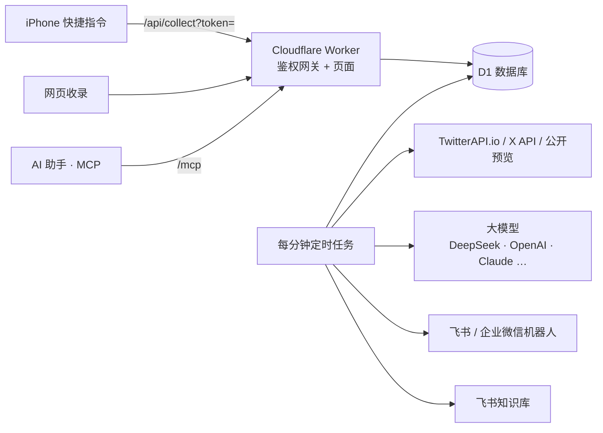

| 目录 | 说明 |
|---|---|
| `cloudflare/worker.ts` | 网关：鉴权、路由、安全响应头、定时任务 |
| `lib/` | 账号与令牌、配置中心、模型调用、X 渠道、订阅、日报、推送、飞书、MCP |
| `app/` | 页面：官网 `welcome`、教程 `guide`、登录/初始化/重置、首页三种风格、阅读页、日报、快捷指令、账号、后台 |
| `drizzle/` | 数据库迁移 |
| `scripts/` | `deploy`、`dev:local`、`setup-link`、`reset-password`、快捷指令构建 |
| `tests/` | `node:test` 测试 |

安全模型与边界见 [SECURITY.md](SECURITY.md)。

## 处理边界

- 单团队访问控制：启用的成员可读取全部资讯，没有逐篇文章权限、多租户或 MFA。
- X 内容获取依赖第三方接口的权限、额度与可用性，不保证私有、已删除或付费内容；暂不展开完整线程或转写视频。
- 网站权限与飞书权限相互独立；停用网站账号不会移除其飞书知识库成员身份。
- 公开收录每 IP 每分钟 30 次；AI 与 X 接口的每日上限可在后台调整。

## 常见问题

**需要哪些费用？** Cloudflare 免费额度通常足够团队使用；大模型和 X 数据接口按各服务商价格计费，后台可设置每日上限。

**没有 X API 能用吗？** 能。选择“仅公开预览”即可读取单条帖子的可见文字；订阅账号与长文章需要 TwitterAPI.io 或 X 官方 API。

**成员要注册吗？** 不需要。管理员添加成员，或生成免密链接发给对方。
