<div align="center">


# X to Group

**把 X 上的好内容，一键带给你的团队。**

From X. For your group.

[看介绍视频](#看-3-分钟介绍视频) · [怎么用](#用起来只有四步) · [动手搭一个](#动手搭一个) · [使用文档](docs/使用文档.md) · [常见问题](#常见问题) · [English](#english)

<a href="docs/media/x-to-group-intro.mp4"></a>

<sub>点击图片观看 3 分钟产品介绍视频（MP4，约 15 MB）</sub>

</div>

## 一句话说清楚

**X to Group 是你们团队自己的 X 资讯库。**

你在 X（推特）上刷到一条好内容，在手机上点一下「分享」，它就进了团队的资讯库：原文和图片都存下来，AI 帮你翻译成中文、写好摘要、分好类。团队里每个人打开网页，就能读中文版，还能搜索、收藏、看每天的 AI 日报。

数据放在你自己的 Cloudflare 账号或服务器里。软件免费使用，代码就在这个仓库里。

## 为什么需要它

你可能遇到过这样的事：

- 在 X 上看到一条很有价值的帖子，转到群里，同事说**打不开**；
- 是一篇英文长文，大家都说「晚点看」，然后**谁也没看**；
- 过两周想找回来，翻了半天聊天记录，**找不到了**。

一个人看到了，不等于整个团队都读到了。X to Group 就是来解决这件事的：X 是信源，Group 是你想分享给的那群人。

## 看 3 分钟介绍视频

视频里用真实界面把整个流程走了一遍：[docs/media/x-to-group-intro.mp4](docs/media/x-to-group-intro.mp4)

## 用起来只有四步

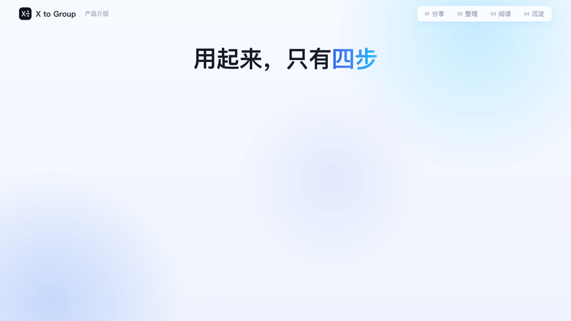

| 步骤 | 你要做的 | 系统帮你做的 |
|---|---|---|
| **① 分享** | 在 X 里点「分享 → 分享到 X to Group」 | 记下是谁分享的、什么时候分享的 |
| **② 整理** | 什么都不用做 | 抓原文和图片，翻译成中文，写摘要、分主题，按团队关注方向打相关度 |
| **③ 阅读** | 打开网页或手机，像刷 X 一样读 | 按主题、订阅账号筛选，关键词一搜就到 |
| **④ 沉淀** | 收藏有用的，需要时导出或存到飞书 | 每天写一份 AI 日报，推送到飞书、企业微信群 |

## 看看长什么样

| 在 X 里点一下，就收录好了 | 原文、译文、摘要，自动整理好 |
|---|---|
|  | 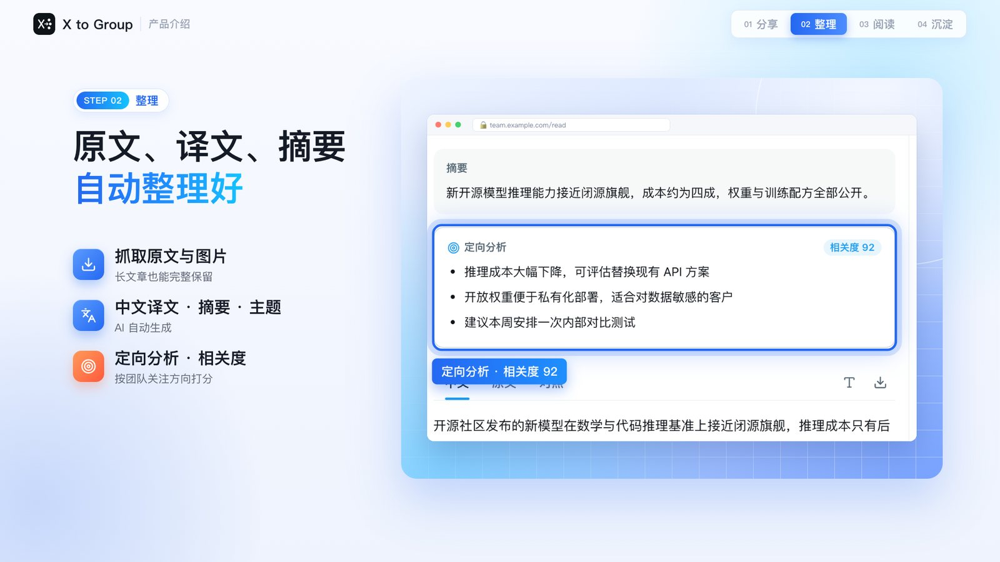 |
| **熟悉的信息流，一搜就到** | **订阅好账号，按信源分组** |
| 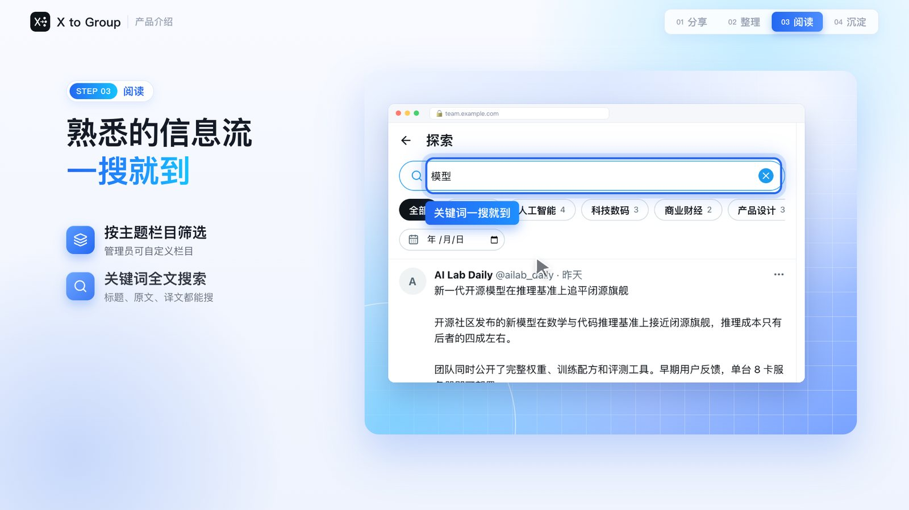 | 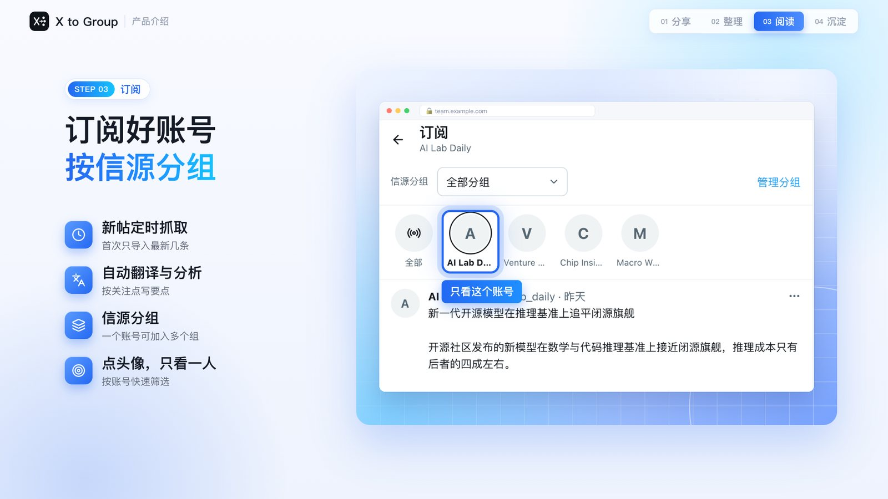 |
| **每天一份团队日报** | **收藏、导出、归档到飞书** |
| 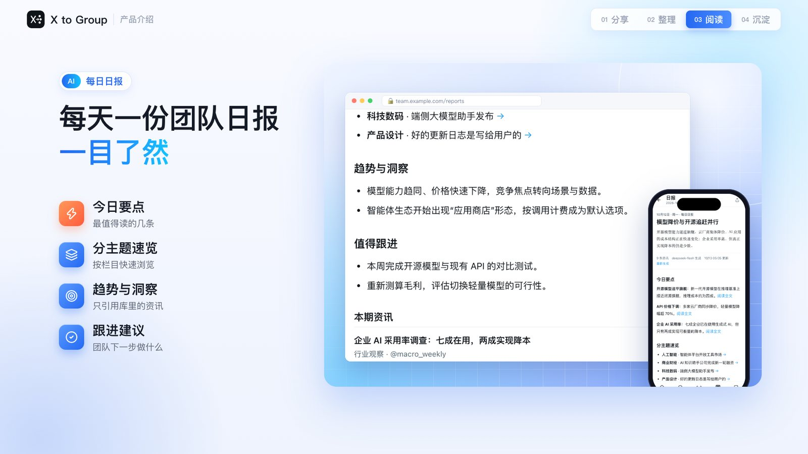 | 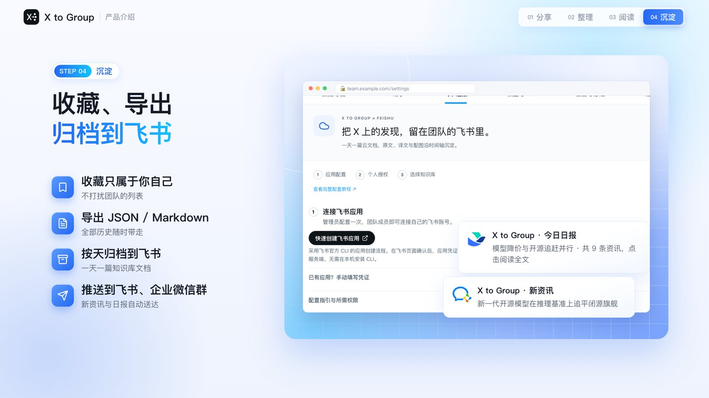 |
| **大模型随你选** | **在 AI 助手里直接用** |
| 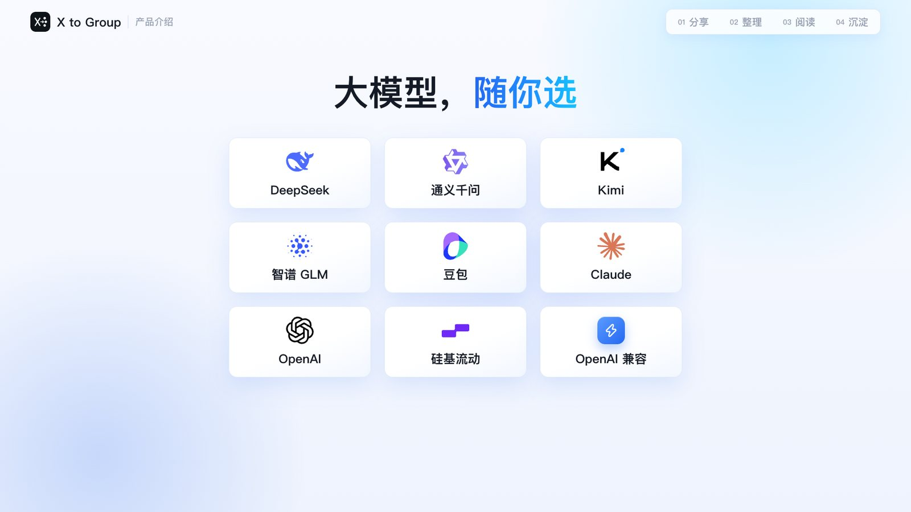 | 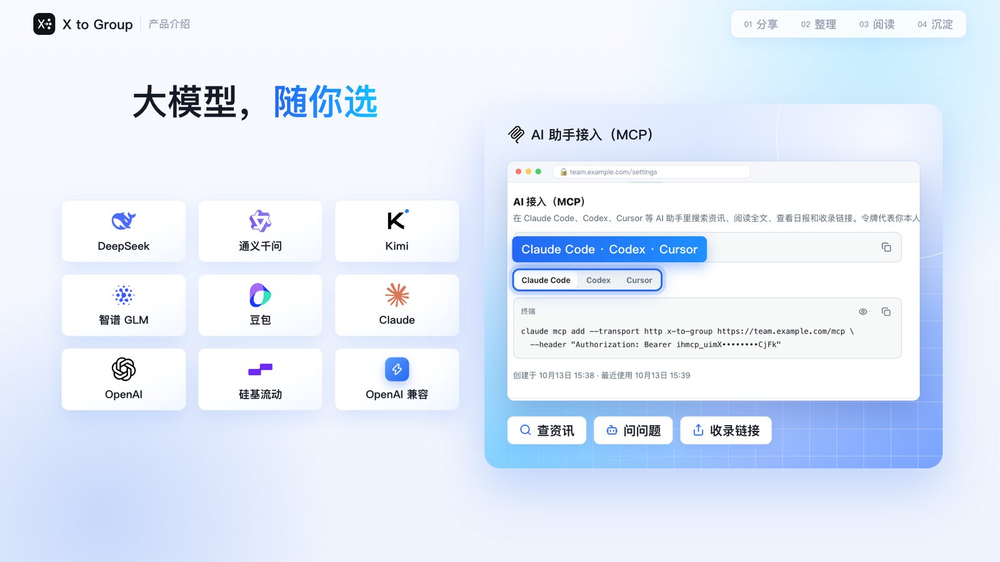 |

真实界面（电脑和手机）：

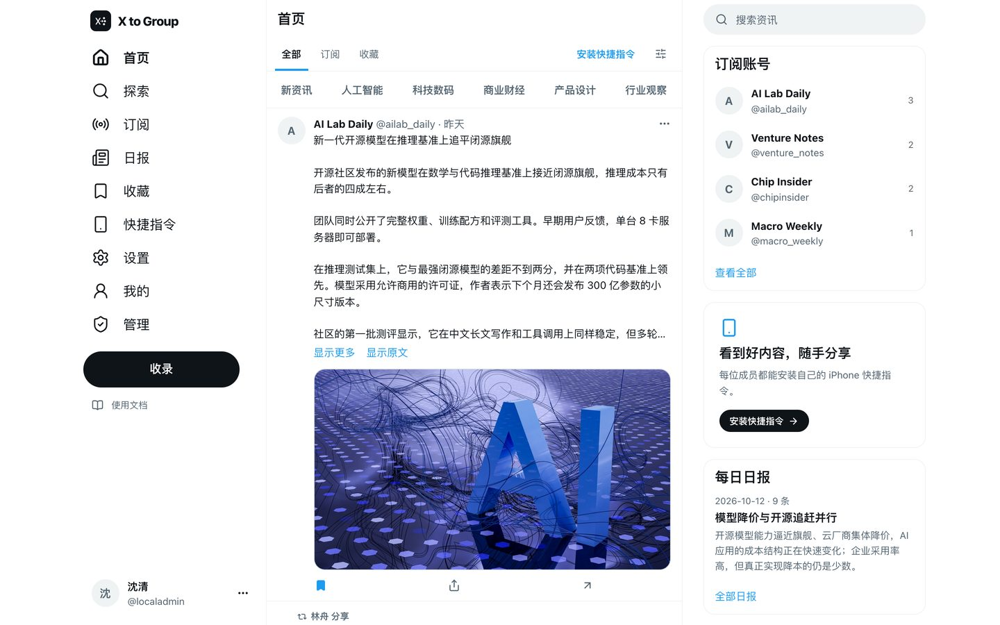 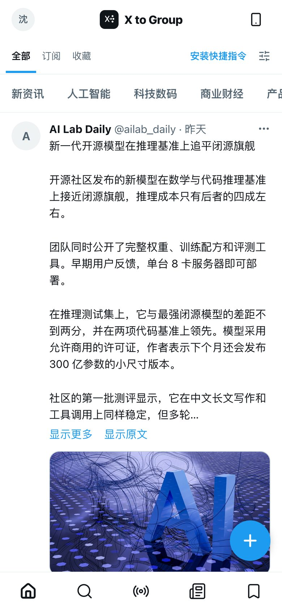

<sub>截图里的内容和人名都是演示数据。</sub>

## 适合谁

- **研发、产品、投资、研究团队**：要持续跟进 X 上开发者、研究者、创业者的一手讨论。
- **几个人到几十人的小团队**：想把「在群里转链接」升级成「有一个团队资讯库」。
- **在意数据的团队**：希望内容和密钥都留在自己手里，不想用第三方 SaaS。

## 能接哪些服务

都在网页后台里配置，随时可以换。

- **X 内容从哪来**：TwitterAPI.io（推荐）、X 官方 API，或「公开预览」（免费，但只能拿到单条帖子的公开文字，不能订阅账号）。
- **用哪个大模型翻译和总结**：DeepSeek、通义千问、Kimi、智谱 GLM、豆包、硅基流动、Claude、OpenAI，或任何兼容 OpenAI 接口的服务。日报可以单独用另一个模型。
- **推送到哪里**：飞书群机器人、企业微信群机器人；还能按天归档到飞书知识库，一天一篇文档。
- **在哪些 AI 助手里用**：Claude Code、Codex、Cursor 等支持 MCP 的工具，可以直接搜索、阅读资讯、问问题、收录链接。

## 动手搭一个

你需要一台装了 **Node.js 22.15 或更新版本**和 **Git** 的电脑。先选好装在哪：

| 装在哪 | 适合谁 | 说明 |
|---|---|---|
| **本地电脑** | 先试试看 | 不需要任何云账号，但只有这台电脑能打开，手机快捷指令用不了 |
| **Cloudflare**（推荐） | 团队正式使用 | 不用买服务器，免费额度一般够小团队用，定时任务不依赖你的电脑开机 |
| **自己的服务器** | 已经有 Linux 服务器和域名 | Docker 一键启动，自动申请 HTTPS 证书 |


### 方法一：让 AI 助手帮你装（最省事）

把下面这段话发给 WorkBuddy、Claude Code、Codex 或 Cursor：

```text
请帮我安装 X to Group：克隆 https://github.com/Satyuki1/information-hub ，
先读仓库里的 AGENTS.md 和 public/agent-install.md，问我要装在本地、Cloudflare
还是自己的服务器，然后按说明安装。登录、付款和授权都由我本人完成；不要把任何
密钥写进聊天或提交到仓库。装好后告诉我访问地址，以及管理员初始化文件在哪里。
```

需要授权 Cloudflare 时，AI 会让你在浏览器里点「允许」，这一步要你自己点。

### 方法二：自己敲几行命令

```bash
git clone https://github.com/Satyuki1/information-hub.git x-to-group
cd x-to-group
npm ci
npm run install:hub
```

`install:hub` 会问你装在哪。也可以直接指定：

```bash
# 本地电脑（装好后打开 http://localhost:8787）
npm run install:hub -- --target=local

# Cloudflare：先在浏览器里授权，再安装
npx wrangler login
npm run install:hub -- --target=cloudflare

# 自己的服务器：把域名换成你的，并把域名解析到这台服务器
HUB_DOMAIN=hub.example.com npm run install:hub -- --target=server
```

### 装好之后，按这个顺序做

1. **创建管理员**：打开只给站点所有者的「管理员初始化链接」，设置账号和密码，然后**下载 20 个恢复码**（忘记密码就靠它）。链接放在：
   - 本地：`work/server-data/setup.md`
   - Cloudflare：`work/bootstrap/管理员初始化.md`
   - 服务器：运行 `docker compose exec app cat /data/setup.md` 查看
2. **接上大模型**：进入「设置 → 模型与 API」，选一个服务商，填 API Key，保存后点「测试」。
3. **选 X 内容来源**：同一页选择抓取渠道。想订阅账号、拿到长文章和图片，需要 TwitterAPI.io 或 X 官方 API 的 Key。
4. **拉同事进来**：「管理 → 成员」里添加账号，或者生成免密登录链接私发给对方。
5. **每人装快捷指令**：每个人用**自己的**账号打开「快捷指令」页，装好 iPhone 快捷指令，在 X 里分享第一条试试。
6. **按需开启**：订阅账号、信源分组、飞书归档、每日日报、群推送。

每一步的截图和细节都在 [使用文档](docs/使用文档.md) 里。部署好的站点里也有同样的文档：`/docs/zh/start`。

> [!IMPORTANT]
> 有两样东西一定要备份：**数据库**和**加密主密钥**。Cloudflare 的主密钥备份在 `work/production-security/DATA_ENCRYPTION_KEY`；本地和服务器版的 `encryption.key` 跟数据放在一起。主密钥丢了，所有密码和已保存的 API Key 都会失效。

### 以后怎么更新

```bash
git pull
npm ci
npm run install:hub -- --target=cloudflare   # 换成你当初选的方式
```

更新会沿用原来的数据库和密钥，数据库迁移只新增、不删除。如果你是 Cloudflare 部署，记得保留 `cloudflare/resources.json`（它记着你的实例对应哪个数据库）。

## 要花多少钱

- **软件**：免费，不收订阅费。
- **Cloudflare**：免费层通常够小团队起步（每天 10 万次请求、500 万行数据库读取）。先用免费层跑一阵，真不够了再考虑付费。
- **大模型**：按你选的服务商价格计费。后台可以设置每天最多调用多少次。
- **X 数据**：「公开预览」免费；TwitterAPI.io 和 X 官方 API 按调用量计费。X 官方 API 新账号首次绑卡可能有一次性赠金，以官方控制台为准。

## 常见问题

**没有 X 的 API，能用吗？**
能。选「公开预览」就能收录单条帖子的公开文字。想订阅账号、拿完整长文章和图片，才需要 TwitterAPI.io 或 X 官方 API。

**成员需要自己注册吗？**
不需要。管理员在后台添加成员，或者生成免密登录链接私发给对方就行。

**用安卓或电脑，没有 iPhone 怎么办？**
打开网页点「收录」，把 X 链接粘贴进去就行。也可以在 Claude Code、Codex、Cursor 这类 AI 助手里收录。

**资讯会被外人看到吗？**
不会。只有登录的成员能看，没登录的访问一律拒绝。每个人的快捷指令口令只能提交内容，不能用来读内容。

**AI 翻译准吗？**
大部分时候不错，但难免出错。关键数字和观点请切到「原文」或「对照」核对一下，一键就能切。

**忘记密码怎么办？**
在登录页用恢复码自己重置；或者请管理员生成重置链接。管理员自己的恢复码也丢了：Cloudflare 部署在当初部署的目录运行 `npm run reset-password -- 用户名`；本地和服务器版请让另一位管理员生成重置链接。

**换了手机，或者快捷指令地址泄露了？**
新手机重新装一遍快捷指令。地址泄露就在「快捷指令」页点「重置」，旧地址立刻失效。

**能不能把数据带走？**
可以。「设置 → 数据导出」能导出全部资讯、你的收藏或你的分享，格式是 JSON 或 Markdown。

更多问题见 [使用文档 · 遇到问题怎么办](docs/使用文档.md#七遇到问题怎么办)。

## 给开发者

- **技术栈**：vinext（Vite 上的 Next.js App Router）+ React 19；运行在 Cloudflare Workers + D1，或 Node.js + SQLite（本地 / Docker）；数据库结构用 Drizzle 管理。
- **本地开发**：`npm ci && npm run dev:local`，打开 http://localhost:8787。
- **提交前检查**：`npx tsc --noEmit`、`npm test`、`npm run build`。
- **给 AI 编程助手看的说明**：[AGENTS.md](AGENTS.md)；安装约定：[public/agent-install.md](public/agent-install.md)。
- **安全模型**：[SECURITY.md](SECURITY.md)。

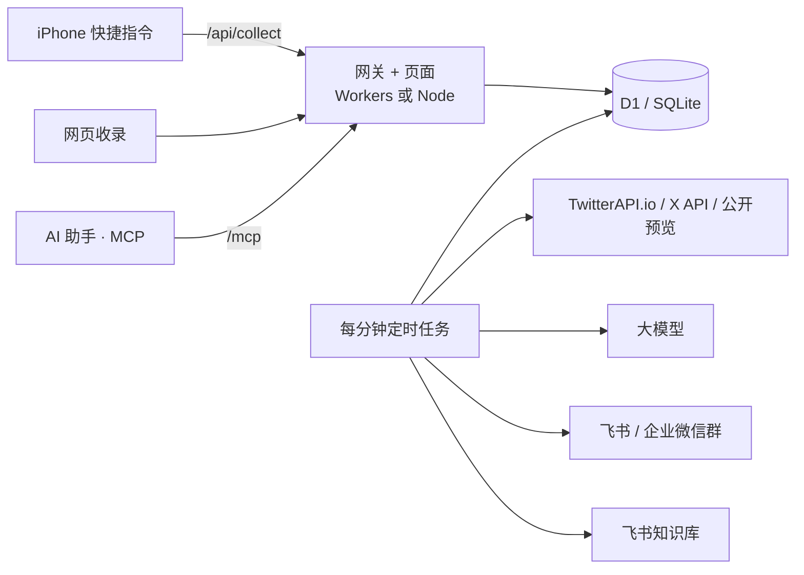

| 目录 | 放的是什么 |
|---|---|
| `app/` | 所有页面：官网、文档、登录、信息流、阅读页、日报、快捷指令、设置、管理后台 |
| `lib/` | 业务逻辑：账号与令牌、配置、模型调用、X 渠道、订阅、日报、推送、飞书、导出、MCP |
| `cloudflare/worker.ts` | Cloudflare 网关：鉴权、路由、安全头、定时任务 |
| `server/` | Node.js + SQLite 运行方式（本地和 Docker） |
| `drizzle/` | 数据库迁移 |
| `scripts/` | 安装、部署、重置密码、生成初始化链接、构建快捷指令 |
| `tests/` | 自动化测试 |

## English

X to Group is a private, self-hosted reading library for teams. Share a post from X with one tap; it keeps the original text and images, adds a Chinese translation, summary and topic, and lets your whole team read, search, bookmark and get an AI daily report in one place. It runs on Cloudflare Workers + D1, locally on Node.js, or on your own server with Docker. Install with `npm ci && npm run install:hub`, or hand [public/agent-install.md](public/agent-install.md) to your coding agent. After deploying, the English guide is at `/docs/en/start`.
