# X to Group 使用文档

> 这份文档讲清楚 X to Group 怎么用：成员怎么上手、每天怎么用、管理员怎么配置、怎么部署和备份，以及遇到问题怎么办。
>
> 部署好的站点里也有一份在线文档，登录后点左侧「使用文档」，或打开 `/docs/zh/start`。截图里的内容和人名都是演示数据。

**目录**

- [一、先认识几个词](#一先认识几个词)
- [二、成员：5 分钟上手](#二成员5-分钟上手)
- [三、每天怎么用](#三每天怎么用)
- [四、管理员：把系统配好](#四管理员把系统配好)
- [五、部署、更新和备份](#五部署更新和备份)
- [六、费用说明](#六费用说明)
- [七、遇到问题怎么办](#七遇到问题怎么办)
- [八、安全和隐私](#八安全和隐私)

---

## 一、先认识几个词

| 词 | 意思 |
|---|---|
| **资讯** | 收进来的一条 X 帖子或长文章。系统会保存原文、图片，并生成中文译文、摘要和主题。 |
| **分享人** | 谁把这条资讯收进来的。用自己的快捷指令分享，就记在自己名下。 |
| **订阅账号** | 管理员设置的「长期关注的 X 账号」。它们发的新帖会被自动收进来，不用人手动分享。 |
| **栏目（主题）** | 首页顶部的分类，比如「人工智能」「商业财经」。AI 会自动给每条资讯分栏目，管理员可以改栏目名称和顺序。 |
| **信源分组** | 把订阅账号分成几组，比如「模型实验室」「投资人」，方便按组浏览。分组只影响怎么看，不影响谁能看。 |
| **定向分析 / 相关度** | 管理员写下团队关心什么，AI 就会给每条资讯写几条「对我们意味着什么」，并打一个 0–100 的相关度分。 |
| **日报** | AI 每天自动写的一份总结：今日要点、分主题速览、趋势和跟进建议。 |
| **管理员 / 成员** | 管理员负责配置和管人；成员负责读、收藏、分享。第一个创建的管理员是「超级管理员」。 |
| **个人连接地址** | 每个人专属的一串地址，装进 iPhone 快捷指令里，用来识别「这条是谁分享的」。它只能提交内容，不能读取内容。 |

---

## 二、成员：5 分钟上手

### 1. 登录

管理员会给你两种账号之一：

- **免密链接**：管理员私发给你一个链接，点开就登录了，不用密码。这个链接等于你的账号，别转发给别人。
- **账号密码**：用管理员给的用户名和初始密码登录。第一次登录会要求你改一个新密码（至少 12 个字符）。

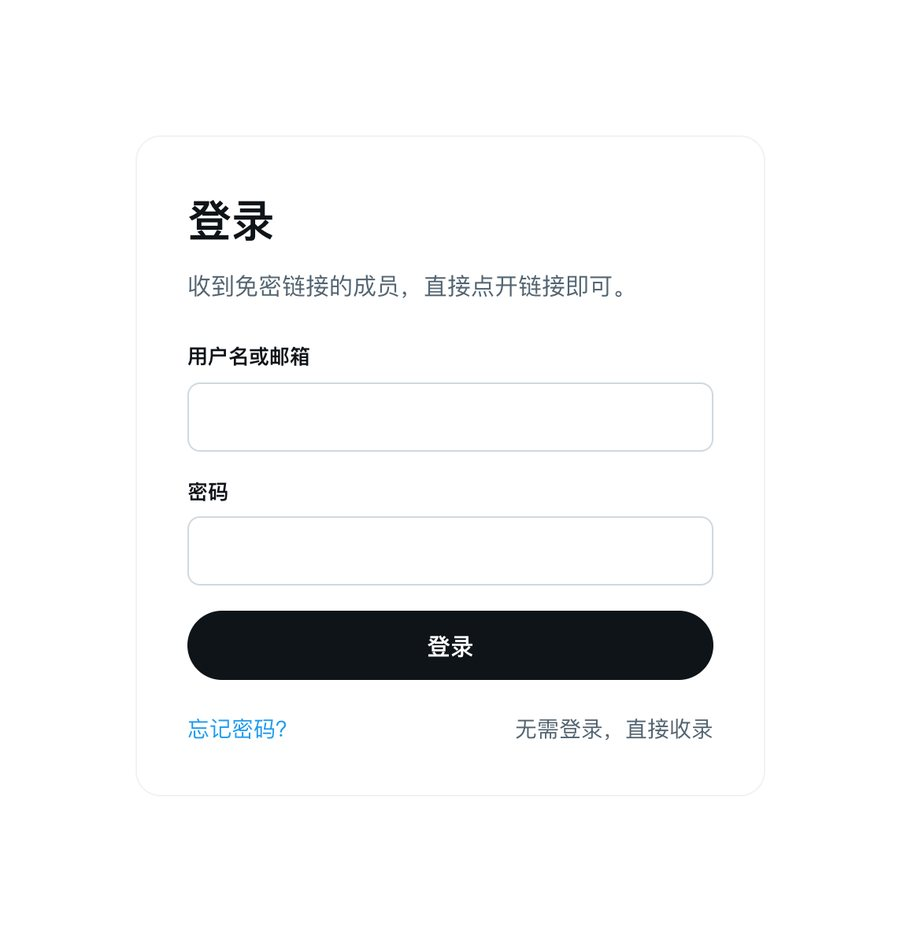

### 2. 认识一下工作台

登录后看到的是一个很像 X 的信息流：


- **左边是导航**：首页、探索（搜索）、订阅、日报、收藏、快捷指令、设置、我的；管理员还会看到「管理」。
- **中间是资讯**：默认显示中文；点「显示原文」看英文；点资讯进入详情。
- **顶部是栏目**：点一个栏目只看这一类，再点一次取消。
- **右边**：搜索框、订阅账号、今天的日报。
- **导航下方的黑色「收录」按钮**：在电脑上手动收一条资讯（见下面第 5 步）。

在手机上打开也一样能用，底部有导航栏：

 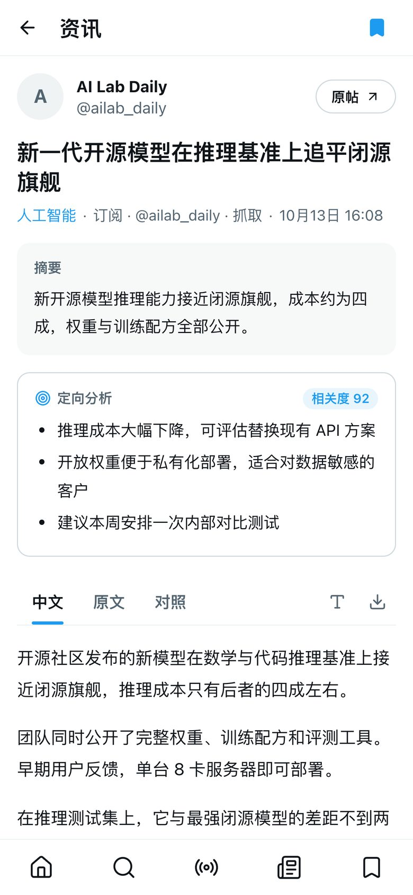

### 3. 安装 iPhone 快捷指令（最重要的一步）

装好以后，在 X 里点一下分享就能收录，这是最常用的方式。

**开始前请确认两件事：**

- 用 **iPhone 自带的 Safari** 打开团队站点，并登录**你自己的**账号。
- 站点得是手机能访问的 HTTPS 地址。如果管理员只在自己电脑上装了「本地版」（地址是 localhost），手机是连不上的。

**三步装好：**

1. 点左侧导航的「快捷指令」，确认页面上显示的是你的名字。
2. 点「**1. 复制个人连接地址**」，再点「**2. 下载并安装新版**」。
3. iPhone 会弹出「设置此快捷指令」，在输入框里**粘贴**刚才复制的地址，点「添加快捷指令」。

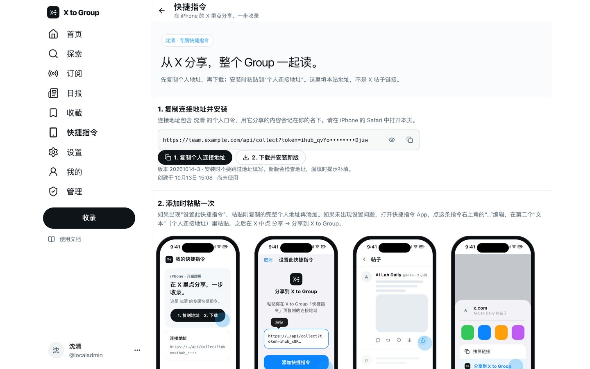

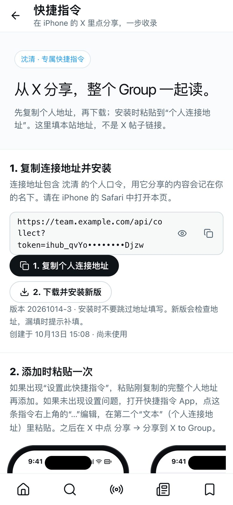

**如果没有弹出「设置此快捷指令」：** 打开苹果的「快捷指令」App，找到「分享到 X to Group」，点右上角「…」进入编辑，把地址粘贴到**第二个**「文本」里（第一个「文本」保持「快捷指令输入」不动），保存即可。

> [!WARNING]
> 别把装好地址的快捷指令转发给同事。每个人都要用自己的账号安装，否则分享会记到你的名下。地址万一泄露，在「快捷指令」页点「重置口令」，旧地址立刻作废，再把新地址填进快捷指令就行。

### 4. 在 X 里分享第一条

1. 在 X 里打开一条帖子，点「分享」，再点系统的分享菜单。
2. 选「**分享到 X to Group**」。第一次可能找不到：在分享菜单最下面点「编辑操作」，把它加到常用里。
3. 第一次运行时，iPhone 会问是否允许连接你的站点，核对是你们的域名后点「允许」。
4. 看到「已收到分享」就可以关掉了。后台会抓原文和图片、翻译整理，一般一两分钟后就出现在首页。

### 5. 没有 iPhone？在网页上收录

在电脑上点左侧导航下方的「收录」按钮（手机上是右下角的「+」），把 X 链接粘贴进去，点「收录」就行。

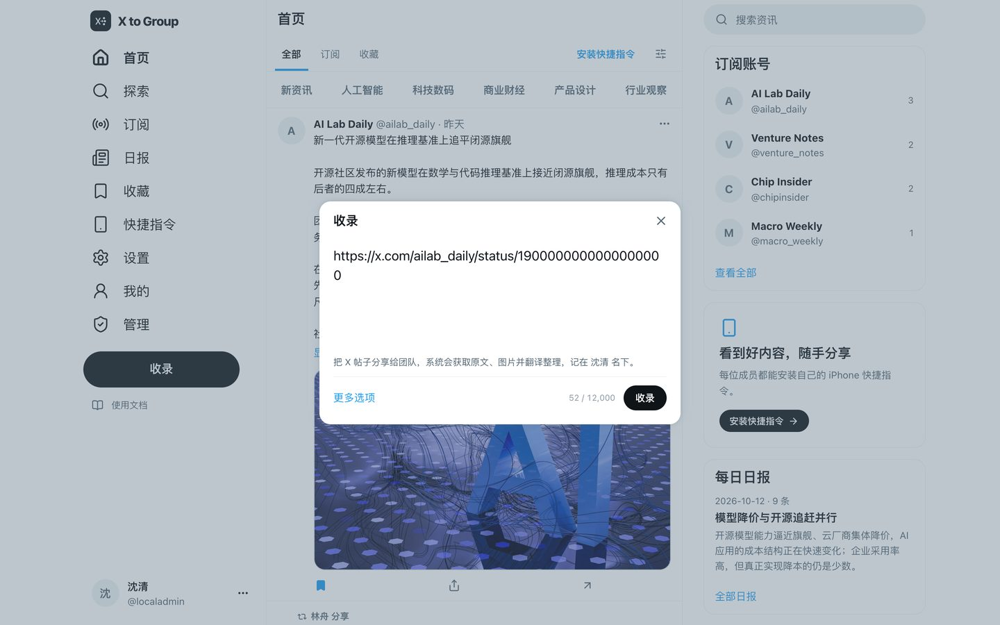

- 帖子打不开或渠道拿不到正文时，可以把你能看到的正文直接粘贴进去。
- 点「更多选项」可以手动指定栏目、写一句备注（「为什么值得一读」）。

---

## 三、每天怎么用

### 读一条资讯

点开任意一条资讯，进入详情页：

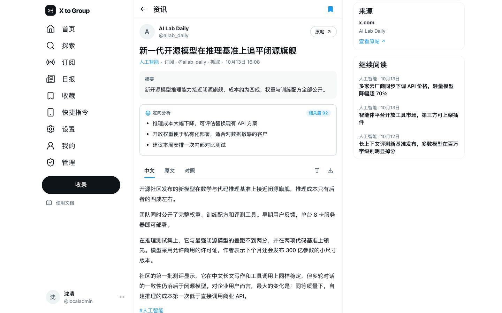

- **摘要**：一两句话告诉你这条讲了什么。
- **定向分析**：如果管理员开启了，这里会写「对我们团队意味着什么」，右上角是相关度分。
- **中文 / 原文 / 对照**：一键切换。对照模式是英文和中文上下对照，方便核对。

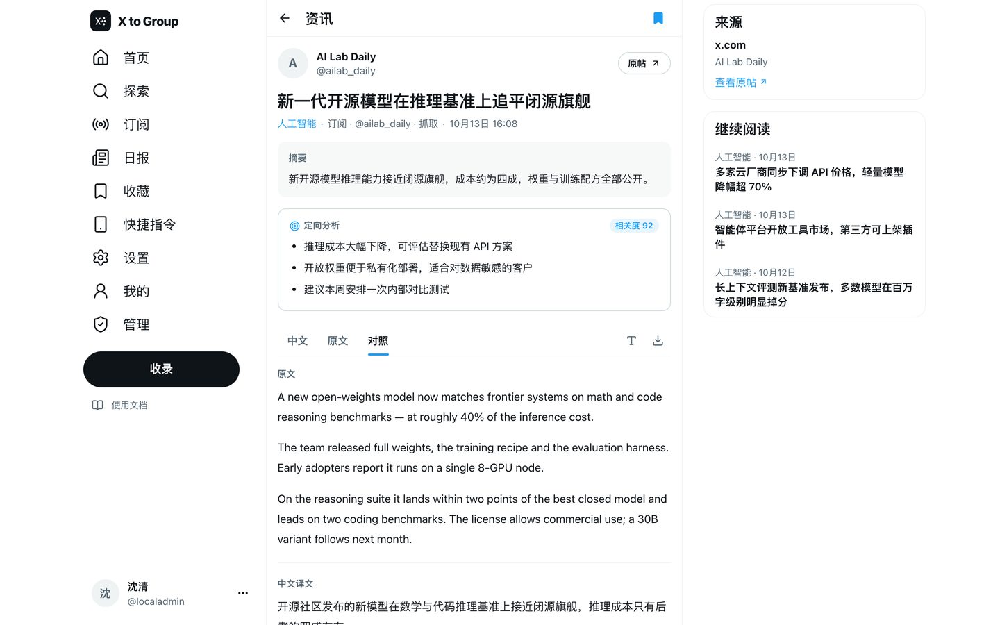

- 右上角的书签按钮是**收藏**；「T」按钮**调字号**；下载按钮导出 **Markdown**。
- 「保存到我的飞书」可以把这条存进你自己的飞书知识库（需要先连接飞书，见下面）。
- 「资讯时间轴」显示什么时候收录、什么时候翻译好、有没有存到飞书。

> AI 翻译大部分时候不错，但难免出错。关键数字、观点和限定词，请切到「原文」或「对照」核对一下。

### 搜索和筛选

点左侧「探索」：输入关键词（标题、原文、译文都能搜到），再按栏目或日期缩小范围。

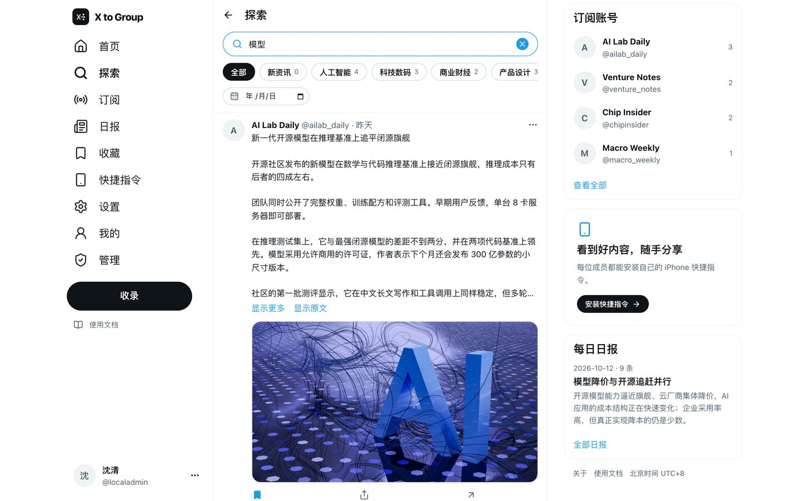

### 看订阅账号

点左侧「订阅」：上面是一排订阅账号的头像，点一个头像就只看这个账号；「信源分组」下拉框可以按组看。

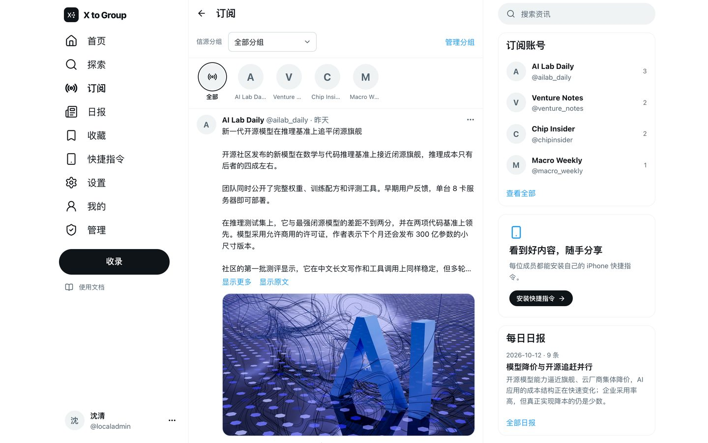

### 收藏

在资讯下面点书签按钮收藏，再点一次取消。左侧「收藏」里**只有你自己的收藏**，别人看不到，也不会打扰团队的信息流。

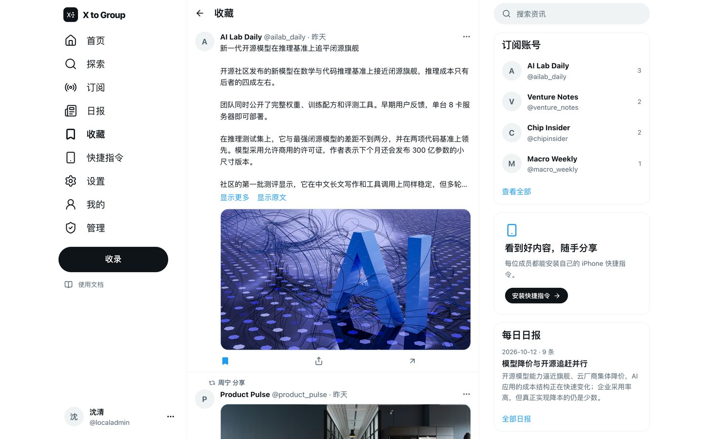

### 看每日日报

点左侧「日报」：每天一篇，包括今日要点、分主题速览、趋势与洞察、值得跟进。日报里的每条要点都能点进原资讯。

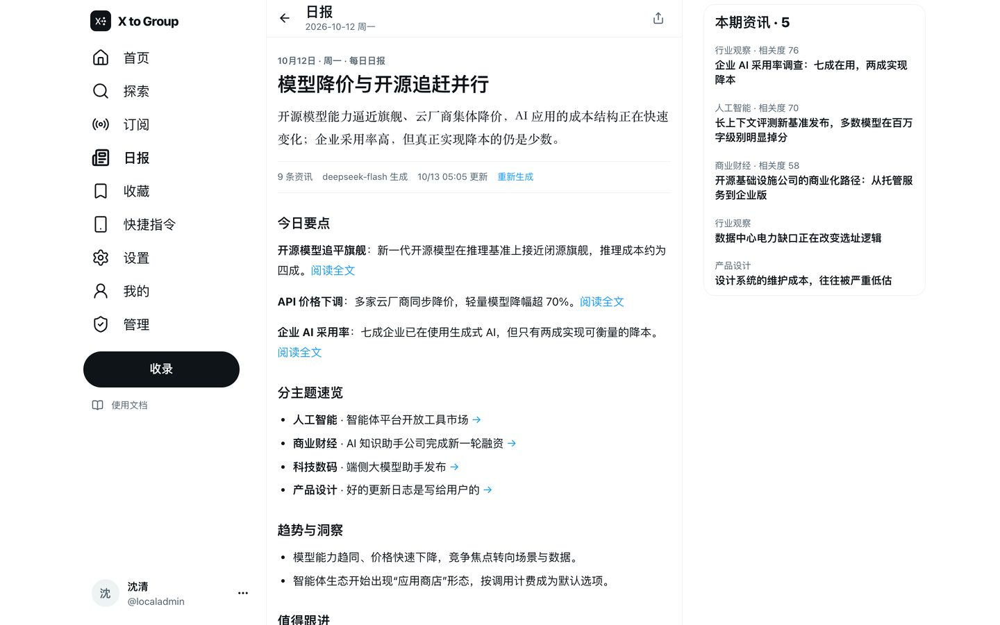

### 把内容导出带走

「设置 → 数据导出」：

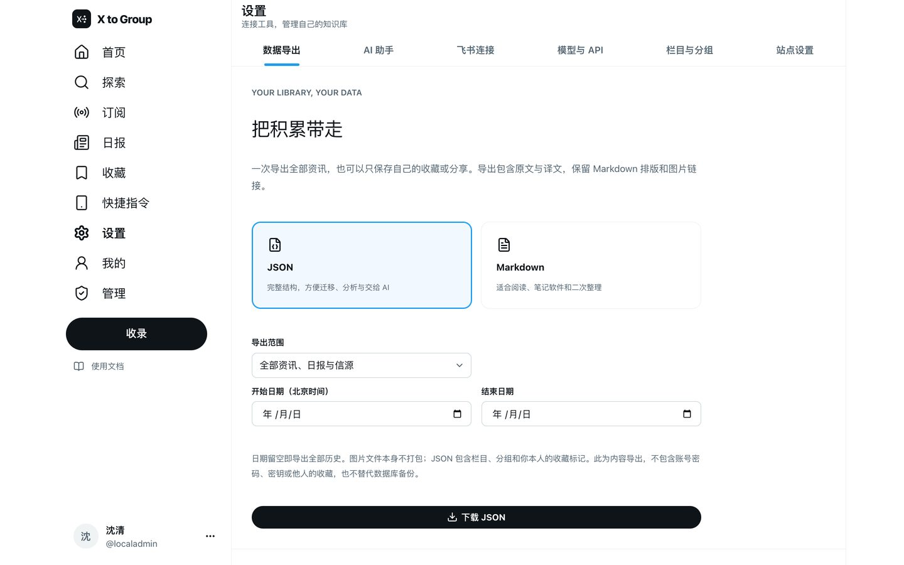

1. 选格式：**JSON**（方便程序处理）或 **Markdown**（方便阅读、放进笔记软件）。
2. 选范围：全部资讯（含日报和订阅账号）、我的收藏，或我的分享。
3. 日期留空就是全部历史；也可以只导某段时间（按北京时间）。
4. 点下载。

导出包含摘要、原文、译文、来源、主题、分析和时间；图片只保留链接，不下载图片文件。它**不包含**密码、密钥和登录信息，也不能代替完整的数据库备份。

### 存到自己的飞书知识库

管理员先把「飞书应用」配好（见第四部分），然后每个人在「设置 → 飞书连接」：

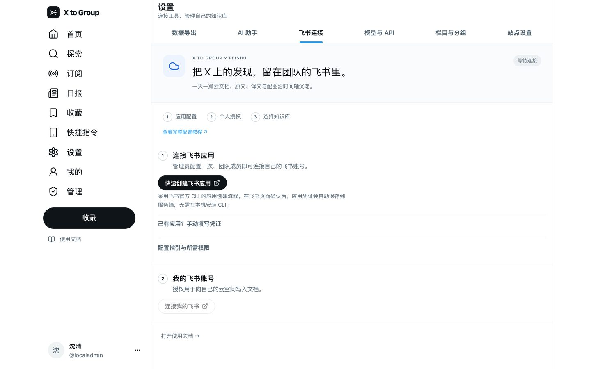

1. 点「连接我的飞书」，在飞书页面核对应用名称和权限，自己点确认。
2. 回到系统，等状态变成「账号已连接」。
3. 在「每日知识库」里新建一个，或选一个你有写入权限的已有知识库。

之后，在资讯详情页点「保存到我的飞书」就能存进去，一天一篇文档。管理员如果开启了「新资讯自动归档」，新资讯整理好后会自动写入。

### 在 AI 助手里用（MCP）

如果你用 Claude Code、Codex 或 Cursor，可以让它们直接搜索和阅读资讯库、问问题，甚至帮你收录链接。

「设置 → AI 助手」：生成你的个人令牌，按页面上对应工具的那段配置复制过去就行。

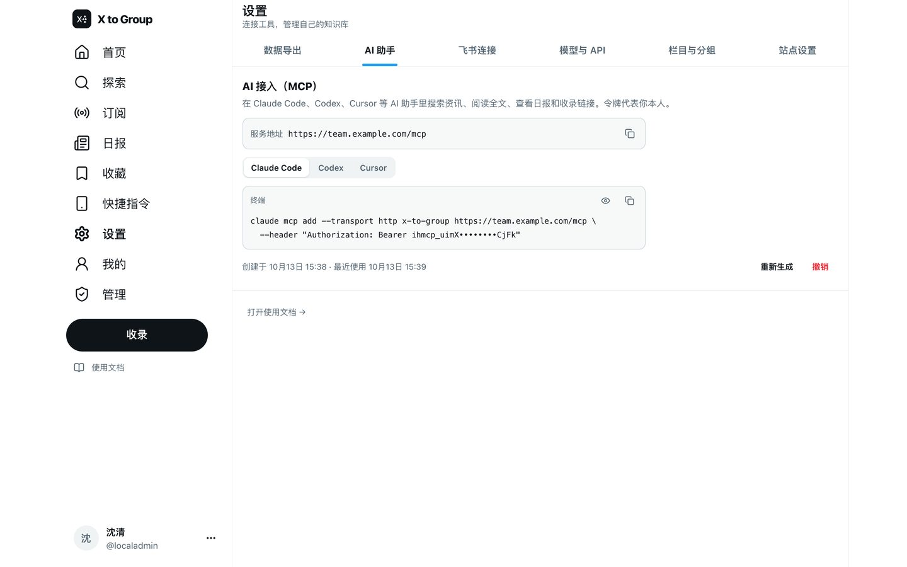

比如 Claude Code，在终端运行页面给出的那条 `claude mcp add ...` 命令即可。令牌代表你本人，不要分享给别人；可以随时「重新生成」或「撤销」。

### 账号安全

「我的」：修改登录密码、查看和重新生成**密码恢复码**。

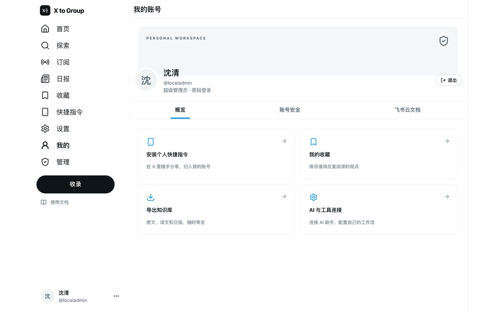

- 恢复码一共 20 个，每个只能用一次。忘记密码时，在登录页用任意一个恢复码自己重置。
- 重新生成后，旧的恢复码全部作废。请把恢复码存在密码管理器之类的安全地方。

---

## 四、管理员：把系统配好

### 1. 创建超级管理员（只做一次）

部署完成后，部署者会拿到一个**只给站点所有者**的初始化链接（在哪里见[第五部分](#五部署更新和备份)）。打开它：

1. 设置管理员的用户名和密码。
2. **下载 20 个恢复码**并妥善保存。

这个链接有效期 24 小时，用过就失效。别把它发到群里。过期了可以重新生成：Cloudflare 运行 `npm run setup-link`，本地 Node 版运行 `npm run server:setup`，Docker 版运行 `docker compose exec app node server/index.mjs --setup-link`。

### 2. 接上大模型和 X 内容来源（必做）

「设置 → 模型与 API」（管理后台里叫「抓取与模型」）。这一页分上下两块，是**两项独立的配置**：

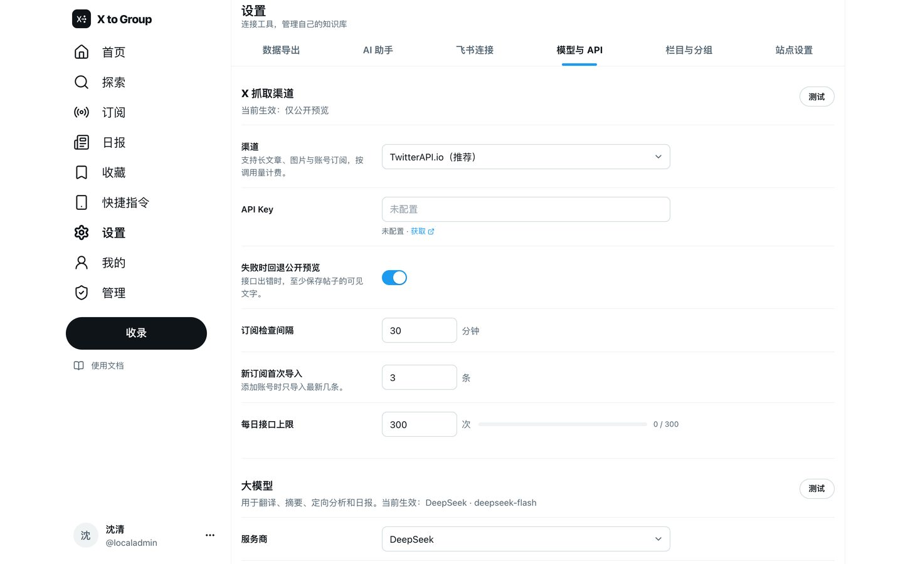

**上面：X 抓取渠道，决定能拿到什么内容**

| 渠道 | 能做什么 | 费用 |
|---|---|---|
| **TwitterAPI.io**（推荐） | 订阅账号、长文章、图片和视频 | 按调用量计费 |
| **X 官方 API** | 官方接口，用开发者控制台的 Bearer Token | 按量计费，以官方价格为准 |
| **仅公开预览** | 只能拿到单条帖子的可见文字，不能订阅账号 | 免费 |

- 「失败时回退公开预览」建议打开：接口出错时，至少保存下帖子的可见文字。
- 还能设置订阅多久检查一次、新订阅首次导入几条、每天最多调用多少次接口。
- 注意别把 X 官方 API 和 xAI（做模型的那个）搞混。

**下面：大模型，负责翻译、摘要、定向分析和日报**

1. 选一个服务商，去它的官网控制台创建 API Key（入口见下表）。聊天产品的会员一般**不等于** API 额度，请看服务商的 API 账单。
2. 填上 Key 和模型名（留空用默认模型），先**保存**，再点「**测试**」。测试会真的调用一次模型。
3. 「日报模型」可以单独指定，留空就和上面一样。
4. 「每日调用上限」控制每天最多调用多少次（翻译、日报和 AI 助手提问共用）。
5. 用自建或第三方兼容服务时，选「自定义（OpenAI 兼容）」并填公网 HTTPS 接口地址；本机或内网地址不能保存，这是为了安全。

| 服务商 | 去哪里拿 Key |
|---|---|
| DeepSeek | https://platform.deepseek.com/api_keys |
| 通义千问 | https://dashscope.console.aliyun.com/ |
| Kimi（月之暗面） | https://platform.moonshot.cn/console/api-keys |
| 智谱 GLM | https://open.bigmodel.cn/usercenter/apikeys |
| 豆包（火山方舟） | https://console.volcengine.com/ark |
| 硅基流动 | https://cloud.siliconflow.cn/account/ak |
| Claude（Anthropic） | https://console.anthropic.com/settings/keys |
| OpenAI | https://platform.openai.com/api-keys |

所有密钥都加密保存在服务器上，页面只显示「是否已配置」，接口不会把密钥返回给浏览器。

### 3. 添加成员

「管理 → 成员」：

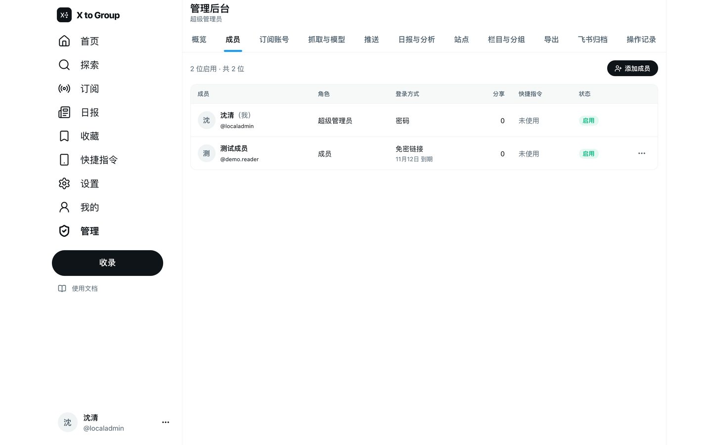

点「添加成员」，选一种登录方式：

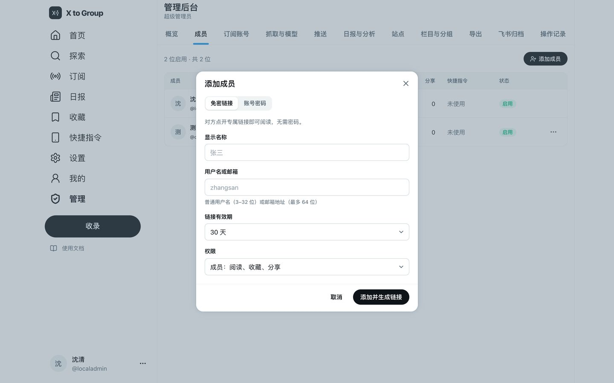

- **免密链接**：对方点开链接就能登录，适合不想记密码的同事。可选有效期：7 天、30 天、90 天、1 年或长期有效。链接**只显示这一次**，请私聊发给本人。
- **账号密码**：设一个至少 12 位的初始密码，对方第一次登录时必须改掉。

权限有两种：**成员**（阅读、收藏、分享）和**管理员**（还能管成员、订阅和系统设置）。

每个成员右边的「…」菜单里还能：重新生成或撤销登录链接、生成密码重置链接（24 小时有效）、设置临时密码、设为管理员 / 成员、停用。**停用后，这个人的登录和个人令牌全部立即失效。**

> 能登录的成员可以读整个资讯库。栏目和信源分组只是阅读视图，不是权限控制。只邀请应该读全部内容的人。

### 4. 订阅账号

「管理 → 订阅账号」：

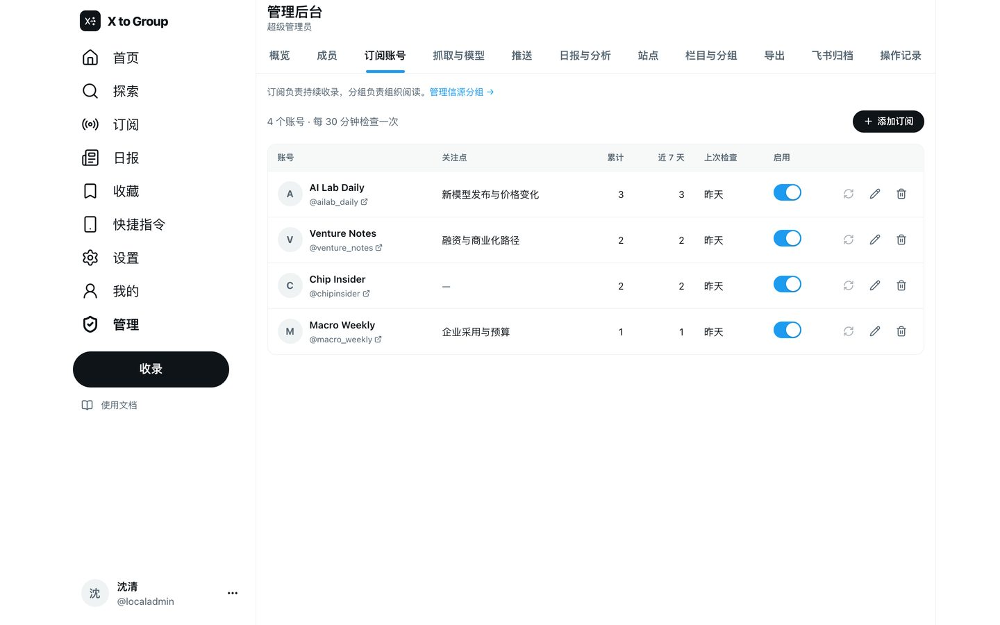

1. 点「添加订阅」，输入 `@账号` 或 X 主页链接（比如 `https://x.com/OpenAI`）。
2. 选填「关注点」，比如「新模型发布、API 价格变化」，它会叠加到全局的定向分析方向上。
3. 按需勾选「包含回复」「包含转帖」。
4. 保存后一分钟内完成首次抓取。首次只导入最新几条，避免一下子灌进一堆历史。

表格里能看到每个账号累计收了多少条、近 7 天多少条、上次检查时间。可以随时「立即检查」、暂停、编辑或删除；删除订阅不会删掉已经收进来的资讯。

> 订阅需要 TwitterAPI.io 或 X 官方 API。用「仅公开预览」时，这里会提示无法读取账号时间线。

### 5. 栏目和信源分组

「设置 → 栏目与分组」：

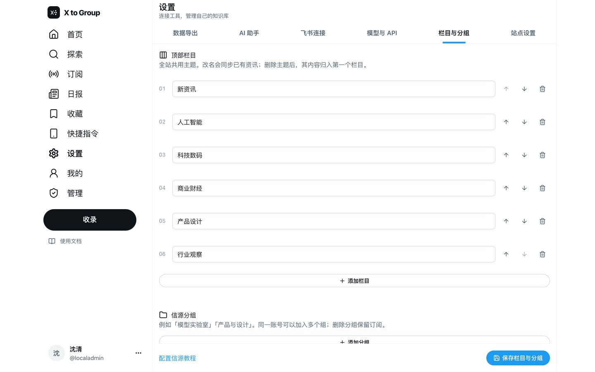

- **顶部栏目**：添加、改名，用上下箭头调顺序，然后保存。改名会同步到已有资讯；删除一个栏目，它下面的资讯会归到第一个栏目，不会删文章。首页刷新后生效。
- **信源分组**：点「添加分组」，起个名字，勾选属于这组的订阅账号，保存。一个账号可以在多个组里；删除分组不影响订阅和已收录的资讯。

### 6. 定向分析和每日日报

「管理 → 日报与分析」：

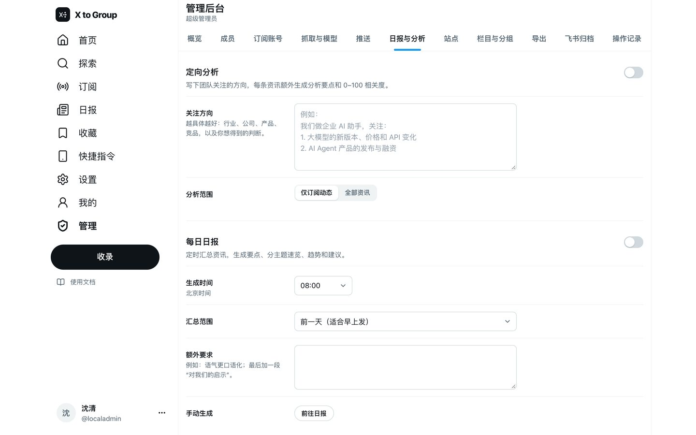

- **定向分析**：打开开关，在「关注方向」里写清楚团队关心什么。越具体越好：行业、公司、产品、竞品，以及你想得到的判断。可以选只分析订阅动态，还是全部资讯。
- **每日日报**：打开开关，选生成时间（北京时间）和汇总范围：前一天（适合早上发）或当天（适合晚上发）；「额外要求」里可以写写作偏好，比如「最后加一段对我们的启示」。也可以随时「手动生成」。

### 7. 推送到飞书群、企业微信群

「管理 → 推送」：

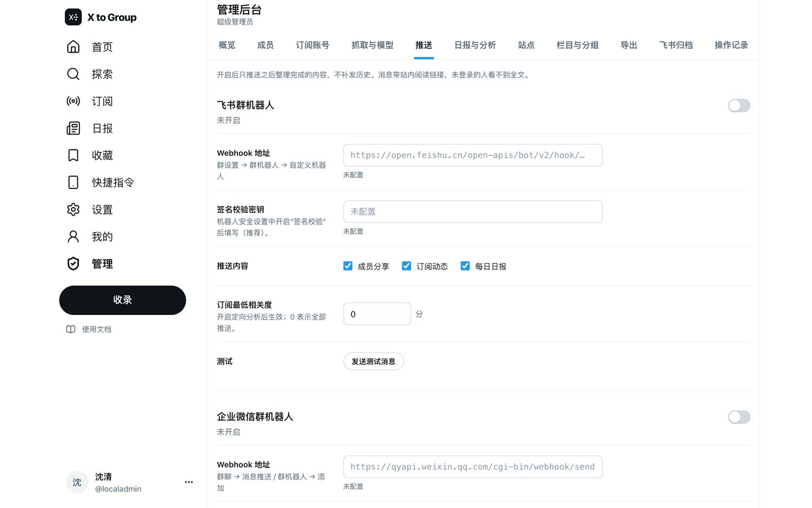

1. **飞书**：群设置 → 群机器人 → 添加自定义机器人，复制 Webhook 地址填进来。建议在机器人安全设置里开启「签名校验」，把密钥也填进来。
2. **企业微信**：群聊 → 消息推送 / 群机器人 → 添加，复制 Webhook 地址填进来。
3. 选推送哪些内容：成员分享、订阅动态、每日日报。
4. 「订阅最低相关度」可以只推送相关度够高的订阅动态（开启定向分析后生效，0 表示全部推送）。
5. 点「发送测试消息」确认能收到。

推送只发开启之后新整理好的内容，不补发历史。消息里带站内阅读链接，没登录的人看不到全文。

### 8. 配置飞书应用（让大家能存到飞书）

「设置 → 飞书连接」里的第一步由管理员完成：

1. 点「**快速创建飞书应用**」，在飞书页面由你本人确认创建，系统会自动保存应用凭证，不用在电脑上装飞书 CLI。
2. 如果你们组织不允许快速创建，去[飞书开发者后台](https://open.feishu.cn/app)创建企业自建应用，再展开「已有应用？手动填写凭证」，填 App ID 和 App Secret。
3. 按页面列出的权限开通知识库、云文档、图片上传和持续授权，按飞书要求发布应用、设置可用范围。

之后每个成员各自连接自己的飞书（见第三部分）。新建的知识库默认不开互联网公开分享；团队阅读权限在飞书里设置。

### 9. 站点设置

「设置 → 站点设置」：

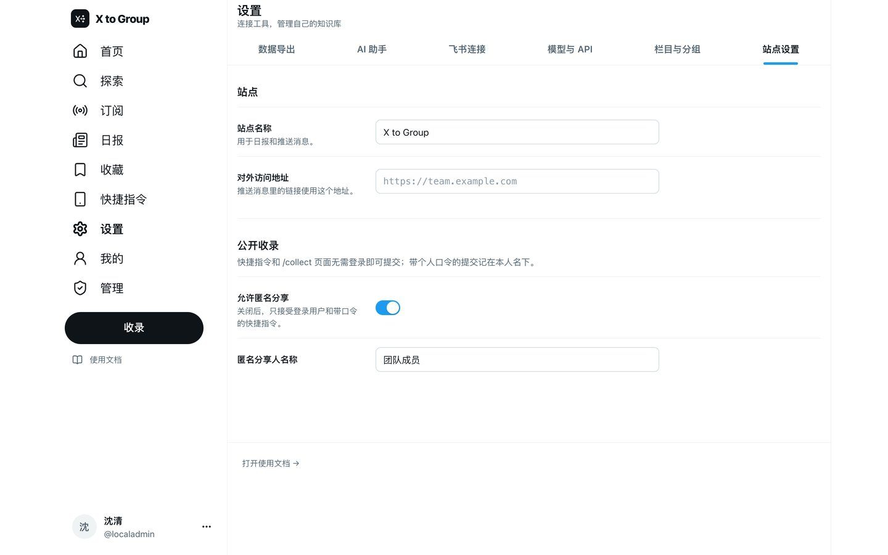

- **站点名称**：显示在日报和推送消息里。
- **对外访问地址**：推送消息里的链接用这个地址，填你们实际访问的 HTTPS 域名。
- **公开收录**：打开后，不登录、不带口令的快捷指令也能提交内容，记在「匿名分享人名称」下；关闭后只接受登录用户和带个人口令的提交。默认建议关闭。

### 10. 看看系统状态

「管理 → 概览」能看到总资讯数、今日新增、待处理数量、近 14 天收录趋势、各项服务是否已开启、今天的 AI 和 X 接口用量，以及分享排行。「操作记录」里有最近 100 条登录和管理操作（不含任何密码或密钥）。

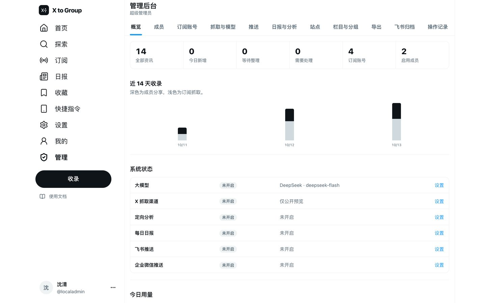

---

## 五、部署、更新和备份

运行前需要 **Node.js 22.15 或更新版本**和 **Git**。

```bash
git clone https://github.com/Satyuki1/information-hub.git x-to-group
cd x-to-group
npm ci
npm run install:hub
```

`install:hub` 会问你装在哪，也可以直接指定 `--target`：

| 方式 | 命令 | 管理员初始化链接在哪 | 以后怎么启动 |
|---|---|---|---|
| **本地电脑** | `npm run install:hub -- --target=local` | `work/server-data/setup.md` | `npm run start:server`（终端要一直开着，定时任务才会跑） |
| **Cloudflare**（推荐） | 先 `npx wrangler login`，再 `npm run install:hub -- --target=cloudflare` | `work/bootstrap/管理员初始化.md` | 部署在 Cloudflare 上，一直在线 |
| **自己的服务器** | `HUB_DOMAIN=你的域名 npm run install:hub -- --target=server` | 运行 `docker compose exec app cat /data/setup.md` 查看 | Docker 自动运行 |

说明：

- **本地版**打开 http://localhost:8787。只有这台电脑能用，手机快捷指令连不上 localhost。
- **Cloudflare 版**：授权要你本人在浏览器里点「允许」。脚本会自动创建数据库、执行迁移、发布并检查是否能访问。
- **服务器版**：需要一台装好 Docker Compose 的 Linux 服务器，域名解析到这台服务器，并开放 80 和 443 端口。Caddy 会自动申请 HTTPS 证书；不要额外对外开放应用自身的 8787 端口。一个数据卷只跑一个实例。

**交给 AI 助手装：** 把仓库地址和「先读 AGENTS.md 和 public/agent-install.md」告诉 WorkBuddy、Claude Code、Codex 或 Cursor 即可。站点上的 `/docs/zh/agents` 页面也能生成一段完整的安装指令。登录、付款和授权始终由你本人完成。

### 装好之后检查一遍

1. 用初始化链接创建超级管理员，下载恢复码。
2. 在「设置 → 模型与 API」配好模型和 X 渠道，都点一下「测试」。
3. 添加成员，让每个人用自己的账号装快捷指令。
4. （可选）配置飞书、订阅、日报和推送。
5. 分享一条真实帖子，确认原文、图片和翻译都正常。

### 更新

```bash
git pull
npm ci
npm run install:hub -- --target=你当初选的方式
```

更新会沿用原来的数据库和密钥，数据库迁移只新增、不删除。Cloudflare 部署请保留 `cloudflare/resources.json`（它记着你的实例对应哪个数据库）；换了新目录更新时，先把这个文件拷过来。

### 备份（一定要做）

| 方式 | 要备份什么 |
|---|---|
| Cloudflare | D1 数据库（`npx wrangler d1 export 数据库名 --remote --output backup.sql`），以及 `work/production-security/DATA_ENCRYPTION_KEY` 和 `cloudflare/resources.json` |
| 本地 Node 版 | 先停掉服务，再备份整个 `work/server-data` 目录 |
| 服务器 Docker 版 | 先停掉 app 容器，再备份整个 `hub-data` 数据卷（里面有数据库和 `encryption.key`），然后再启动 |

> [!CAUTION]
> **加密主密钥（`DATA_ENCRYPTION_KEY` / `encryption.key`）一定要和数据库一起备份。** 它丢了，所有密码和已保存的 API Key 都会失效。更新时也不要重新生成它。Docker 版千万别运行 `docker compose down -v`，那会删掉数据卷。

「数据导出」导出的是内容，不是完整备份，不能用来恢复整个系统。

---

## 六、费用说明

- **软件本身**：免费，不收订阅费。
- **Cloudflare**：免费层每天 10 万次请求、500 万行数据库读取、10 万行写入，账户总存储 5 GB（截至 2026-10-13，以[官方价格页](https://developers.cloudflare.com/workers/platform/pricing/)为准）。小团队通常够用，先用免费层跑一阵看实际用量。
- **大模型**：按服务商价格计费，和 X 的额度互不通用。在「设置 → 模型与 API」里设置每日调用上限，避免意外花费。
- **X 数据**：「公开预览」免费。TwitterAPI.io 和 X 官方 API 按调用量计费；X 官方 API 新账号首次绑卡可能有一次性赠金，规则以[官方说明](https://docs.x.com/x-api/getting-started/free-credits)为准。订阅的账号越多、检查越频繁，花费越高。

---

## 七、遇到问题怎么办

| 现象 | 怎么办 |
|---|---|
| 快捷指令提示「未指定 URL」 | 到「快捷指令」页复制完整的个人连接地址，在快捷指令编辑器的**第二个**「文本」里粘贴并保存。 |
| 分享菜单里找不到「分享到 X to Group」 | 在分享菜单最下面点「编辑操作」，把它加到常用里。 |
| 手机分享时连不上 | 先用手机 Safari 打开同一个域名试试。打不开说明站点手机访问不到（比如装的是本地版 localhost），需要换成能公网访问的 HTTPS 部署。 |
| 收进来了，但没有正文 | 检查 X 抓取渠道是否配置好。「公开预览」可能只能拿到一部分；也可以在网页「收录」里手动粘贴正文。 |
| 一直显示「整理中」 | 检查「模型与 API」里的 Key 和额度，点「测试」。本地版的终端必须保持运行，否则定时任务不会跑。 |
| 模型测试报 401 | Key 不对、已失效，或者填到了别的服务商下面。 |
| 模型测试报 403 | 没有权限或者地区限制。 |
| 模型测试报 429 | 额度不够、余额不足或调用太频繁。 |
| 提示「模型不存在」 | 换成服务商当前列表里有的模型名。 |
| 订阅页提示无法读取账号时间线 | 抓取渠道是「仅公开预览」，订阅需要 TwitterAPI.io 或 X 官方 API。 |
| 飞书提示权限不足 | 补齐应用权限和可用范围，重新发布应用，再连接个人账号。 |
| 管理员初始化链接过期了 | Cloudflare：`npm run setup-link`；本地 Node：`npm run server:setup`；Docker：`docker compose exec app node server/index.mjs --setup-link`。 |
| 成员忘记密码 | 用恢复码在登录页自己重置；或管理员在「成员」里生成重置链接。 |
| 管理员忘记密码，恢复码也丢了 | Cloudflare 部署：在当初部署的目录运行 `npm run reset-password -- 用户名`，一小时有效的链接会写进 `work/reset/`。本地和服务器版：请另一位管理员生成重置链接。 |
| 导出下载到一半断了 | 缩小日期范围再试，并看看服务器日志。别把下载了一半的 JSON 当成完整备份。 |

---

## 八、安全和隐私

- **只有登录的成员能读资讯**。没登录的访问会被拒绝；个人快捷指令地址只能提交内容，不能读取内容。
- **密钥加密保存**：模型 Key、X 接口凭证、机器人地址都用主密钥加密存储，页面和接口不会把它们显示或返回出来。
- **收藏、快捷指令地址和 AI 助手令牌都是个人的**。令牌和地址可以随时重置或撤销，停用成员会让他的登录和令牌全部失效。
- **数据在你自己手里**：存在你自己的 Cloudflare 账号或服务器里。导出功能可以随时把内容带走。
- **权限边界**：系统按「站点成员」管理阅读权限，没有单篇文章级权限、多租户或双因素登录。网站权限和飞书权限分开管理，停用网站账号不会自动移除他在飞书知识库里的权限。

更多技术细节见仓库里的 [SECURITY.md](../SECURITY.md)。
